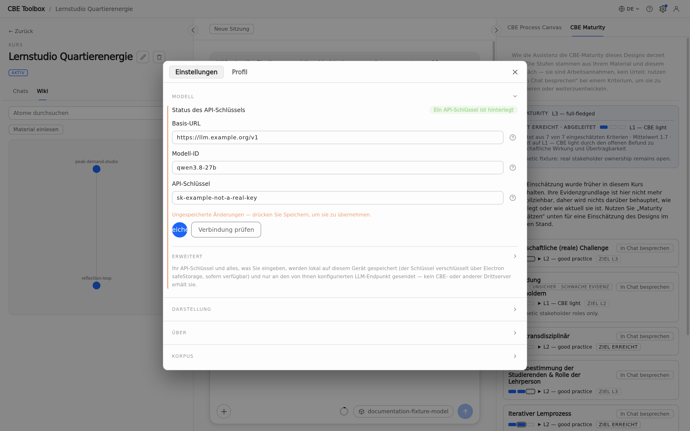

# Installation

Anleitung für **CBE Toolbox 0.1.21 / CBE Skill 0.4.2**.

<a id="what-is-cbe-toolbox"></a>

## Was ist die CBE Toolbox?

Die CBE Toolbox ist eine KI-gestützte Anwendung, die Dozierende dabei unterstützt, Kurse und Module im Sinne der Challenge-Based-Education-Didaktik (CBE) zu erstellen, wie sie in PIONEER definiert ist. Sie führt Dozierende durch einen strukturierten Gestaltungsprozess und berücksichtigt dabei ihre spezifischen Ziele, Hintergründe und ihren Kontext. Im Zentrum der Anwendung steht ein KI-gestützter Chatbot, der mit Expertenwissen zu CBE aus dem PIONEER-Konsortium angereichert ist.

Ein zentrales Gestaltungsprinzip der Toolbox ist, Dozierende darin anzuleiten, wo sie bei der Gestaltung eines CBE-Moduls kognitiven Aufwand investieren, statt ihnen diesen Aufwand abzunehmen. Sie liefert keine fertigen Lösungen, sondern regt dazu an, Gestaltungsentscheide zu reflektieren und eigene Lösungen zu entwickeln. Die Arbeit mit der Toolbox kann deshalb mehr aktive Beteiligung erfordern als eine gewöhnliche KI-Chat-Oberfläche. Das ist beabsichtigt: So behalten Dozierende die Verantwortung und bauen eigene Expertise zu CBE auf.

Ausführliche technische Anleitungen folgen unten und im Code-Repository. Kurz gesagt folgt die Anwendung dem Prinzip „Bring Your Own AI“: Nutzende können (und müssen) ihren eigenen KI-Endpunkt konfigurieren. Prompts werden an diesen Endpunkt gesendet und können Informationen über die nutzende Person sowie Kontext aus Gesprächen enthalten. Berücksichtigen Sie deshalb die Datenverarbeitungs- und Datenschutzbedingungen des gewählten KI-Anbieters; siehe [Datenschutz, Daten und Ablage](privacy-data-storage.md). Abgesehen von den Prompts werden Informationen lokal auf dem Gerät der nutzenden Person gespeichert.

Die Anwendung kann als installierbare Datei für Windows, macOS oder Linux heruntergeladen werden. Mobile Betriebssysteme wie Android oder iOS werden derzeit nicht unterstützt (wir gehen davon aus, dass Module in der Regel nicht auf dem Smartphone geplant werden). Eine Cloud- oder Web-Variante ist derzeit ebenfalls nicht verfügbar. Verbieten Sicherheitsrichtlinien einer Organisation die Installation, können IT-Abteilungen eine eigene, sicherheitsgeprüfte Version bauen und verteilen. Dafür steht der Quellcode unter einer permissiven Lizenz zur Verfügung, die auch Änderungen und Beiträge erlaubt.

<a id="local-it"></a>

<!-- topic:local-it -->

## Verteilung durch IT-Abteilungen

IT-Abteilungen sind der wichtigste Verteilkanal für die CBE Toolbox: Sie stellen die Anwendung den Dozierenden bereit, zum Beispiel über das Softwareportal der Institution, und sie stellen die Zugangsdaten (API-Schlüssel) für ein KI-Modell zur Verfügung.

### Anwendung bauen

Das Repository der Virtuellen Akademie unter [https://github.com/virtuelleakademie/cbe-toolbox](https://github.com/virtuelleakademie/cbe-toolbox) ist der baubare, generierte Quellcode-Mirror: der bereinigte Quellcode der CBE Toolbox und der Einstiegspunkt der Community für Beiträge über Issues. Verwenden Sie Node.js **22.19 oder neuer** und das mitgelieferte npm.

Offizielle Downloads, einschliesslich des signierten und notarisierten macOS-Releases, bleiben auf der bestehenden öffentlichen [Download-Seite der CBE Toolbox](https://cbe-toolbox.pages.dev/#download). Offizielle GitHub-Releases, Release-Automation, OTA-Veröffentlichung und Cloudflare-Betrieb sind nicht zum Quellcode-Mirror verschoben worden. Anwendungsupdates und die Verantwortung für Releases bleiben beim kanonischen Projekt.

Unter Linux oder macOS klonen und prüfen Sie den Mirror so:

```sh
git clone https://github.com/virtuelleakademie/cbe-toolbox
cd cbe-toolbox
npm ci
npm run build
npm test
```

Erstellen Sie den Installer auf der Zielplattform:

- macOS: `npm run dist:mac --workspace packages/app`
- Windows: `npm run dist:win --workspace packages/app`
- Linux: `npm run dist:linux --workspace packages/app`
- Prüfsummen: `npm run checksums --workspace packages/app`

Die Dateien werden nach `packages/app/release/` geschrieben.

Der öffentliche GitHub-Actions-Workflow übergibt `CBE_DEFAULT_LLM_API_KEY` nie. Öffentliche Tag- und manuelle Builds starten deshalb ohne vorkonfigurierten Schlüssel und zeigen die einmalige BYO-Provider-Einrichtung. Das Packaging-Skript unterstützt weiterhin einen separat kontrollierten Opt-in-Build: Übergibt ein Operator die Variable ausdrücklich ausserhalb des öffentlichen Workflows, wird der Schlüssel zum Standard für den ersten Start. Fehlt die Variable oder ist sie leer, entfernt das Skript vor dem Packaging jede veraltete generierte Standarddatei. Nutzende können die Verbindung im Einstellungs-Overlay weiterhin ändern oder löschen. Der optionale Standard für Endpunkt und Modell steht in `packages/app/src/main/default-connection.ts`.

### Windows-Installer bauen und prüfen

Für Windows nutzt der unterstützte Weg zwei Plattformen und genau einen Commit:

- **Linux, eine Linux-VM oder WSL** führt die vollständige Codeprüfung aus: saubere Installation, Build und die vollständige Testsuite.
- **Natives Windows** kompiliert die Anwendung, paketiert den NSIS-Installer und hält seine Prüfsumme fest.
- **Eine saubere Windows-VM oder ein sauberes Windows-Gerät** installiert genau diesen Installer, startet ihn und führt begrenzte Smoke-Checks aus.

Die vollständige Testsuite ist unter nativem Windows kein unterstütztes Prüftor. Führen Sie sie dort nicht anstelle des Linux-Laufs aus, und akzeptieren Sie in keinem Lauf rote Tests: Ein roter Test im unterstützten Linux-Lauf ist ein Fehler und sollte als Issue im Quellcode-Mirror gemeldet werden.

#### 1. Vollständige Codeprüfung unter Linux, in einer Linux-VM oder unter WSL

Wählen Sie den zu bauenden Commit (normalerweise den aktuellen Stand von `main`), setzen Sie seinen vollständigen SHA in die erste Zeile ein und verwenden Sie denselben SHA auf beiden Maschinen. Klonen Sie unter WSL in das Linux-Dateisystem (zum Beispiel `~/src`), nicht unter `/mnt/c`: Das eingehängte Windows-Laufwerk bringt genau die Windows-Dateisemantik zurück, die die Suite nicht unterstützt, und ist deutlich langsamer.

```sh
COMMIT=PASTE-THE-FULL-COMMIT-SHA
mkdir -p ~/src && cd ~/src
git clone https://github.com/virtuelleakademie/cbe-toolbox
cd cbe-toolbox
git checkout --detach "$COMMIT"
git rev-parse HEAD
sha256sum package-lock.json
node --version
npm --version
npm ci
npm run build
npm test
```

Jeder Test muss bestehen. `npm run verify:mirror` führt dieselbe Prüfspur aus, die der Release für den Mirror ausführt (Build, Tests, Lint und Aktualität generierter Dateien). Die Electron-Layouttests laufen nur, wo `xvfb-run` und die Systembibliotheken von Electron installiert sind, und werden sonst übersprungen.

#### 2. Unter nativem Windows kompilieren und paketieren

Installieren Sie Git for Windows und Node.js 22.19 oder neuer (x64). Verwenden Sie in PowerShell denselben Commit:

```powershell
$Commit = "PASTE-THE-FULL-COMMIT-SHA"
git clone https://github.com/virtuelleakademie/cbe-toolbox C:\src\cbe-toolbox
cd C:\src\cbe-toolbox
git checkout --detach $Commit
git rev-parse HEAD
(Get-FileHash package-lock.json -Algorithm SHA256).Hash.ToLower()
node --version
npm --version
npm ci
npm run build
Remove-Item Env:CBE_DEFAULT_LLM_API_KEY -ErrorAction SilentlyContinue
$env:CSC_IDENTITY_AUTO_DISCOVERY = "false"
npm run dist:win --workspace packages/app
npm run checksums --workspace packages/app
Get-Content packages\app\release\SHA256SUMS.txt
```

Der Installer wird nach `packages\app\release\CBE-Toolbox-<version>-x64.exe` geschrieben, neben `SHA256SUMS.txt`. Es werden weder ein Signaturzertifikat noch Signatur-Zugangsdaten, ein Release-Token oder ein Standard-Secret für das LLM benötigt: Das Ergebnis ist ein unsignierter Installer ohne vorkonfigurierten Modellschlüssel, deshalb zeigt der erste Start die einmalige Provider-Einrichtung. Ihr Installer ist voraussichtlich nicht byte-identisch mit dem offiziellen Release-Asset; seine Prüfsumme bindet die gebaute an die installierte Datei.

#### 3. Auf einer sauberen Windows-VM oder einem sauberen Gerät installieren und prüfen

1. Kopieren Sie die EXE und `SHA256SUMS.txt` auf eine Windows-VM oder ein Windows-Gerät ohne frühere Installation der CBE Toolbox.
2. Prüfen Sie die Prüfsumme mit `Get-FileHash .\CBE-Toolbox-*-x64.exe -Algorithm SHA256`. Sie muss mit der Zeile für diese Datei in `SHA256SUMS.txt` übereinstimmen.
3. Führen Sie den Installer aus. Eine Installation für den aktuellen Benutzer braucht keine Administratorrechte. Weil der Installer unsigniert ist, kann SmartScreen warnen; wählen Sie **Weitere Informationen** → **Trotzdem ausführen** oder wenden Sie die Freigaberegeln Ihrer Institution an.
4. Starten Sie die CBE Toolbox über das Startmenü. Der erste Start zeigt die einmalige Provider-Einrichtung.
5. Geben Sie Endpunkt, Modell-ID und Schlüssel Ihrer Institution ein, speichern Sie und verwenden Sie den Verbindungstest in derselben Einstellungsgruppe. Senden Sie eine kurze Chat-Nachricht und prüfen Sie, dass eine Antwort eintrifft.
6. Schliessen Sie die Anwendung und starten Sie sie neu; die gespeicherte Verbindung ist weiterhin vorhanden.
7. Deinstallieren Sie die Anwendung optional über die Windows-Liste der installierten Apps und prüfen Sie, dass das Programm entfernt ist.

Diese Checks belegen, dass dieser Installer unter Windows installiert, startet und Ihren Modellservice erreicht. Sie ersetzen die Codeprüfung unter Linux nicht, und der Linux-Lauf belegt den Installer nicht.

#### 4. Protokolle vergleichen

Führen Sie pro Build ein Protokoll und vergleichen Sie es zwischen beiden Maschinen:

| Angabe                                     | Erwartung                                                  |
| ------------------------------------------ | ---------------------------------------------------------- |
| Commit-SHA (`git rev-parse HEAD`)          | identisch unter Linux und Windows                          |
| SHA-256 von `package-lock.json`            | identisch unter Linux und Windows                          |
| `sourceCommit` in `MIRROR_PROVENANCE.json` | identisch (folgt aus dem Commit)                           |
| Versionen von Node.js und npm              | auf beiden 22.19 oder neuer; idealerweise dieselbe Version |
| SHA-256 des Installers                     | identisch auf der Build-Maschine und auf dem Zielgerät     |

Unterscheiden sich Commit oder Lockfile-Hash, deckt das Linux-Testergebnis den Installer nicht ab; bauen Sie dann vom passenden Commit neu.

#### Warum zwei Plattformen

Die offizielle Release-Pipeline arbeitet genauso: Ihre vollständige Testsuite läuft unter Linux, und der native Windows-Job installiert, baut und paketiert denselben Commit und veröffentlicht die Prüfsumme des Installers. Die Snapshots des Quellcode-Mirrors werden auf dieselbe Weise geprüft, und kein Nachweis behauptet einen nativen Windows-Durchlauf der Testsuite.

Die Testsuite wurde für Linux geschrieben und läuft dort. Unter nativem Windows schlug sie früher aus Gründen fehl, die in den Annahmen der Tests selbst lagen und nicht in der Anwendung: POSIX-Dateimodi und -Berechtigungen, symbolische Links, `/` als Pfadtrenner und gebietsschemaabhängige Ausgaben. Die Anwendungsfehler, die bei der Untersuchung dieser Fehlschläge gefunden wurden, Zeilenenden beim Checkout und ein Datei-Flush beim Aktivieren von Skill und Korpus, sind behoben, und hostunabhängige Regressionstests dafür laufen in der Linux-Suite. Ein nativer Lauf von `npm test` unter Windows ist deshalb in keiner Richtung Teil des Nachweises: Die beiden grünen Läufe oben sind es.

### Modellservice bereitstellen

Die CBE Toolbox folgt einem Bring-your-own-provider-Modell. Die Institution stellt einen eigenen GPU-basierten Inferenzdienst oder einen freigegebenen externen Provider bereit.

Geben Sie den Nutzenden:

- eine OpenAI-kompatible HTTPS-Basis-URL;
- einen Prozess zum Bezug eines API-Schlüssels;
- die verfügbaren Modell-IDs;
- unterstützte Einstellungen für Kontextfenster und Reasoning;
- Informationen zu Datenschutz, Aufbewahrung, Training und Region des Providers.

Die Endgeräte benötigen ausgehenden HTTPS-Zugriff auf diesen Endpunkt. Die App verwendet die Routen für Modellliste und Chat Completions. Auf dem Gerät der dozierenden Person muss kein eingehender Port geöffnet werden.

Lokale Ablage und Sicherung beschreibt [Was lokal gespeichert wird](privacy-data-storage.md#local-storage). Provider-Schlüssel gehören nicht in gemeinsame Skripte, Tickets oder Dokumentation.

<a id="install-current-build"></a>

<!-- topic:installation-current-build -->

## Installation für Endnutzer:innen

> [!CAUTION]
> Die Anleitung beschreibt die Installation auf gewöhnlichen Endgeräten. Institutionell verwaltete Geräte können die Installation einschränken. In diesem Fall müssen sich Endnutzer:innen an ihre lokale IT-Abteilung wenden. Die Anbieter der CBE Toolbox leisten keinen individuellen Installationssupport.

Gehören Sie zu einer Institution der PIONEER-Allianz, prüfen Sie zuerst im Softwareportal Ihrer Hochschule (zum Beispiel dem Unternehmensportal für verwaltete Geräte), ob die CBE Toolbox dort bereits verfügbar ist. Falls nicht, wenden Sie sich an Ihre IT-Abteilung und fragen Sie nach Zugangsdaten für ein KI-Modell (LLM).

Um die App selbst zu installieren, laden Sie das aktuelle öffentliche Release auf der [Download-Seite der CBE Toolbox](https://cbe-toolbox.pages.dev/#download) herunter. Wählen Sie den Installer für Ihr Betriebssystem.

Das macOS-Release ist mit einer Apple Developer ID signiert und von Apple notarisiert. Der Windows-Installer bleibt unsigniert; Edge oder SmartScreen können deshalb weiterhin warnen. Das Linux-AppImage ist absichtlich unsigniert; prüfen Sie vor dem Start seine Prüfsumme.

### macOS

1. Laden Sie die DMG-Datei für Apple Silicon (`arm64`) herunter.
2. Öffnen Sie die DMG-Datei und ziehen Sie **CBE Toolbox** nach **Programme**.
3. Öffnen Sie **CBE Toolbox** aus Programme. Ein Terminal-Befehl oder eine Gatekeeper-Umgehung ist nicht erforderlich.

### Windows

1. Laden Sie den EXE-Installer herunter.
2. Falls Edge den Download blockiert, öffnen Sie das Download-Menü und wählen **Beibehalten** → **Mehr anzeigen** → **Trotzdem beibehalten**.
3. Klicken Sie mit der rechten Maustaste auf die Datei, öffnen Sie **Eigenschaften**, aktivieren Sie falls vorhanden **Zulassen** und wählen Sie **OK**.
4. Starten Sie den Installer. Die Installation für den aktuellen Benutzer reicht aus und benötigt keine Administratorrechte.
5. Falls SmartScreen erscheint, wählen Sie **Weitere Informationen** → **Trotzdem ausführen**. Fehlt diese Möglichkeit aufgrund einer Richtlinie, wenden Sie sich an die lokale IT.

### Linux

1. Laden Sie das AppImage herunter.
2. Machen Sie die Datei ausführbar und starten Sie sie:

   ```sh
   chmod +x CBE-Toolbox-*.AppImage
   ./CBE-Toolbox-*.AppImage
   ```

### Download prüfen

Auf der Build-Seite finden Sie auch `SHA256SUMS.txt`. Vergleichen Sie die Prüfsumme vor dem Öffnen:

- macOS: `shasum -a 256 CBE-Toolbox-*.dmg`
- Windows PowerShell: `Get-FileHash CBE-Toolbox-*.exe -Algorithm SHA256`
- Linux: `sha256sum CBE-Toolbox-*.AppImage`

Die ausgegebene Prüfsumme muss der Zeile für Ihre Datei in `SHA256SUMS.txt` entsprechen.

<a id="model-connection"></a>

<!-- topic:model-connection -->

## Modell verbinden

Die CBE Toolbox benötigt Zugriff auf ein KI-Modell. Öffentliche Releases enthalten keinen Standard-API-Schlüssel. Eine frische Installation zeigt deshalb die bestehende einmalige Provider-Einrichtung; Ihre IT-Abteilung kann die Verbindungsdaten bereitstellen, oder Sie verwenden einen eigenen OpenAI-kompatiblen Provider. Ein separat kontrollierter institutioneller Build kann weiterhin mit einem Standard für den ersten Start paketiert werden, der öffentliche Release-Workflow tut dies jedoch nicht.

Nachrichten und das für eine Anfrage relevante Material werden an den konfigurierten Provider gesendet. Prüfen Sie dessen Datenschutz- und Aufbewahrungsbedingungen, bevor Sie Kursmaterial hinzufügen. Siehe [Lokale Speicherung und Übermittlung an den Provider](privacy-data-storage.md#provider-data-flow).

So richten Sie die Verbindung ein:

1. Öffnen Sie das Einstellungs-Overlay über das Zahnrad oben rechts im Anwendungsfenster.
2. Öffnen Sie die Gruppe mit Endpunkt, Modell-ID und Schlüssel.
3. Tragen Sie Basis-URL, Modell-ID und API-Schlüssel Ihrer IT-Abteilung oder Ihres Providers ein.
4. Speichern Sie die Verbindung und verwenden Sie danach die Testfunktion in derselben Gruppe. Der Test prüft die gespeicherte Verbindung.
5. Wechseln Sie zurück ins Chatfenster und probieren Sie einen Chat aus. Sehen Sie statt einer Antwort des Modells eine Fehlermeldung, lesen Sie im Abschnitt zur Fehlerbehebung [Das Modell ist nicht konfiguriert oder der Verbindungstest scheitert](troubleshooting-and-reference.md#model-connection-fails) nach.

<!-- screenshot:model-settings:example-values:desktop -->



_Die Modellgruppe mit eingetragenen, noch nicht gespeicherten Beispielwerten. Basis-URL und API-Schlüssel sind erfundene Beispiele, kein echter Endpunkt und kein echter Schlüssel; verwenden Sie die Angaben Ihrer IT-Abteilung oder Ihres Providers._

Ein Update lässt die bestehende lokale Provider-Konfiguration und den verschlüsselten Schlüssel unverändert. Insbesondere kann eine Installation, auf der zuvor v0.1.17 lief, den dort gespeicherten Zugang behalten, bis der Provider-Verantwortliche diesen Schlüssel separat widerruft. v0.1.18 löscht oder migriert ihn nicht, weil die App einen früher eingebetteten Schlüssel nicht zuverlässig von einem durch die dozierende Person eingegebenen Schlüssel unterscheiden kann.

Schreiben Sie einen API-Schlüssel nie in einen Chat, Screenshot oder Supportfall.

<!-- ui:settings-gear -->
<!-- ui:settings-panel -->
