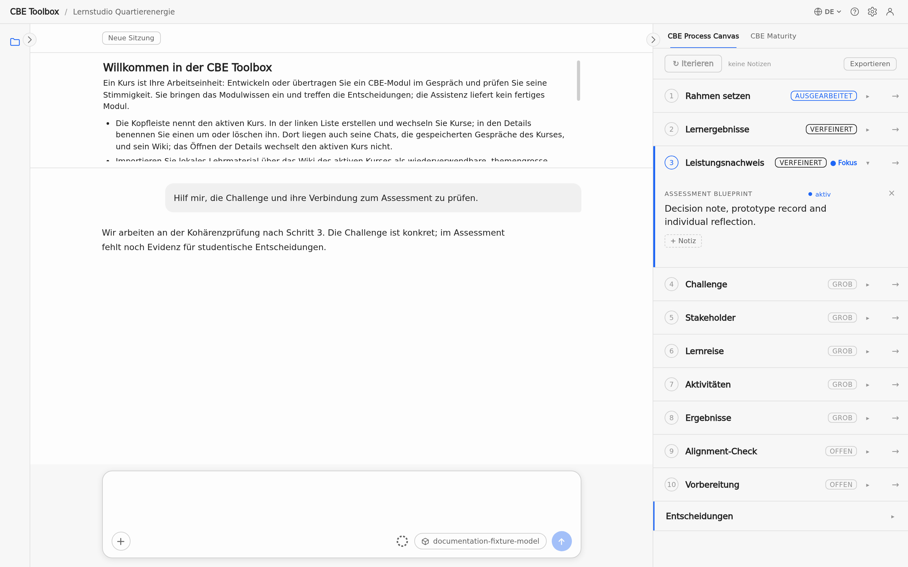
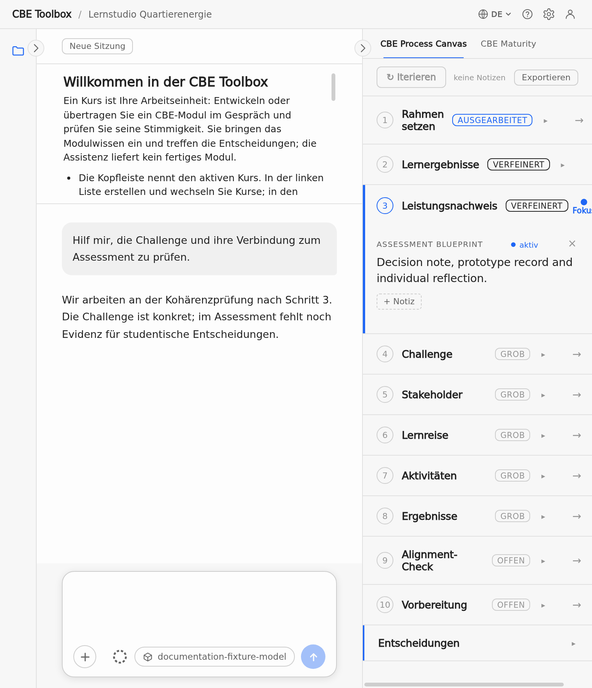

# Schnellstart

Erstellen Sie einen Course und senden Sie Ihre erste nützliche Anfrage.

<!-- topic:first-course-and-request -->

## Vom ersten Start zur nützlichen Arbeit

1. **Aktuellen Build installieren.** Laden Sie ihn unter [Installation für Endnutzer:innen](installation-and-local-it.md#install-current-build) herunter.

2. **Modellverbindung prüfen.** Falls Ihre Institution sie nicht vorkonfiguriert hat, folgen Sie [Modell verbinden](installation-and-local-it.md#model-connection).
   <!-- ui:settings-panel -->

3. **Course erstellen oder auswählen.** Öffnen Sie die Kursliste über den Kursnamen oben. Erstellen Sie einen Course für das Modul, das Sie gestalten, übertragen oder prüfen möchten, oder wählen Sie einen bestehenden Course.
   <!-- ui:header-course-name -->

4. **Arbeit beschreiben.** Formulieren Sie eine konkrete Anfrage, zum Beispiel:
   - „Hilf mir, dieses Seminar auf CBE zu übertragen. Beginne bei der Herausforderung in der Leistungsbewertung.“
   - „Prüfe die Challenge in meinem aufgezeichneten Entwurf kritisch.“

5. **Bei Bedarf Material ergänzen.** Fügen Sie eine kurze Beschreibung ein oder hängen Sie eine lokale Datei an. Importieren Sie Material ins Course Wiki, wenn Sie es in späteren Chats wiederverwenden möchten. Siehe [Anhang oder Course Wiki?](user-guide.md#attachment-versus-wiki).
   <!-- ui:material-upload -->

6. **Anfrage senden.** Enter sendet, Shift+Enter fügt eine neue Zeile ein. Course-Daten bleiben in dieser Installation. Der konfigurierte Modell-Provider erhält das für die Antwort benötigte Material. Siehe [Lokale Speicherung und Übermittlung an den Provider](privacy-data-storage.md#provider-data-flow).
   <!-- ui:send-stop -->

<!-- screenshot:first-use-orientation:default:desktop -->

_Die Übersicht zeigt die wichtigsten Bereiche und die ersten Schritte._

<!-- screenshot:first-use-orientation:default:narrow -->

_Die schmale Ansicht zeigt die Übersicht über Gespräch und Eingabefeld._

## Falls Sie nicht weiterkommen

- Modellverbindung: [Modell verbinden](installation-and-local-it.md#model-connection)
- Fehler in App oder Antwort: [Häufige Symptome und sichere Wiederherstellung](troubleshooting-and-reference.md#troubleshooting)
- Fragen zu Material und Datenschutz: [Datenschutz, Daten und Ablage](privacy-data-storage.md)
