# Leitfaden für Dozierende

So gestalten, übertragen und prüfen Sie CBE-Module mit der Toolbox.

<!-- topic:purpose-and-limits -->

## Zweck und Grenzen

Mit der Toolbox können Sie **ein CBE-Modul gestalten, bestehende Lehre auf CBE übertragen oder einen Entwurf kritisch prüfen**. Sie hält Entscheidungen sichtbar, prüft die Kohärenz und stellt CBE-Methodik bereit. Fachliche, institutionelle und abschliessende Entscheide bleiben bei Ihnen.

<!-- topic:workspace-orientation -->

## Orientierung im Arbeitsbereich

Der aktive **Course** besitzt seine Chats, den aufgezeichneten Entwurf und sein Wiki. Links gelangen Sie zu Courses und deren gespeicherten Chats/Wiki. In der Mitte liegt das Gespräch. Rechts befinden sich **CBE Process Canvas**, der aufgezeichnete Entwurf, und **CBE Maturity**, eine Arbeitseinschätzung dieses Entwurfs. Person und Zahnrad oben rechts öffnen Profile und Settings für die ganze App. Der Kursname im Kopfbereich zeigt immer, welcher Course aktiv ist.

<!-- ui:header-course-name -->

Unterscheiden Sie die Flächen:

- Im **Gespräch** entstehen Begründungen, Fragen und Entscheidungen.
- **CBE Process Canvas** hält vereinbarte Gestaltungselemente fest.
- **CBE Maturity** schätzt den aufgezeichneten Entwurf anhand der sieben PIONEER-Maturity-Kriterien ein.
- Das **Course Wiki** enthält wiederverwendbares Material, das Sie für diesen Course importiert haben.
- Der **Corpus** ist die mitgelieferte, kuratierte CBE-Methodik.

<!-- screenshot:workspace-orientation:default:desktop -->

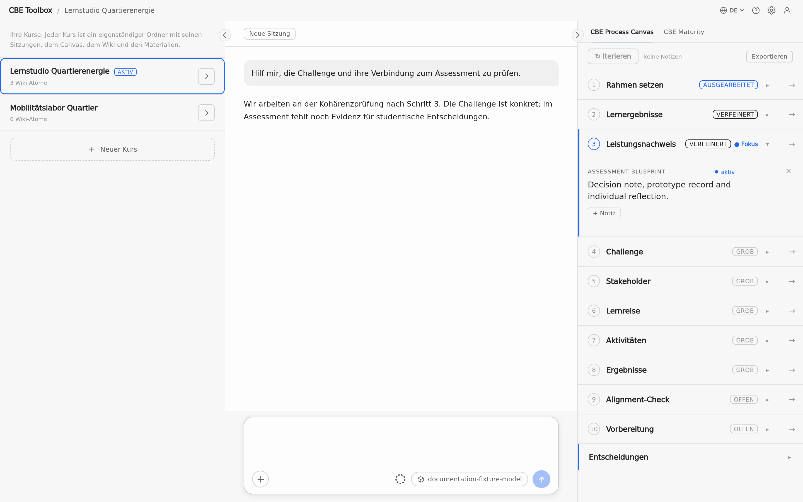

_Der Arbeitsbereich zeigt links die Courses, in der Mitte das Gespräch und rechts den CBE Process Canvas._

<!-- screenshot:workspace-orientation:default:narrow -->

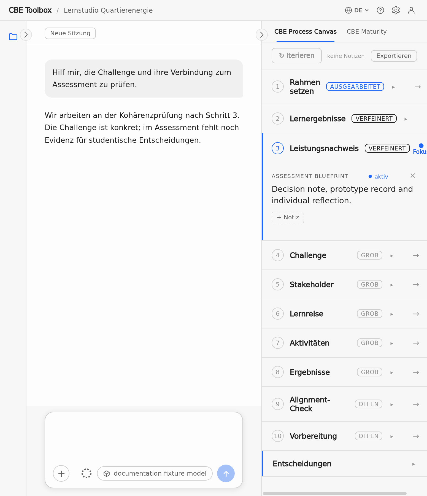

_Die schmale Ansicht zeigt das Gespräch zwischen den eingeklappten Seitenpanels._

<!-- topic:course-lifecycle -->

## Courses

Öffnen Sie die Kursliste über den Kursnamen oben. Erstellen Sie einen Course, wählen Sie einen anderen oder öffnen Sie seine Details zum Umbenennen und Löschen. Beim Wechsel ändern sich Gespräch, Canvas, Maturity und Wiki gemeinsam. Beim Löschen wandert der Course-Ordner in den Papierkorb des Betriebssystems. Laufende Antworten und Wiki-Importe müssen vorher enden.

<!-- ui:header-course-name -->

<!-- screenshot:course-management:create-switch:desktop -->

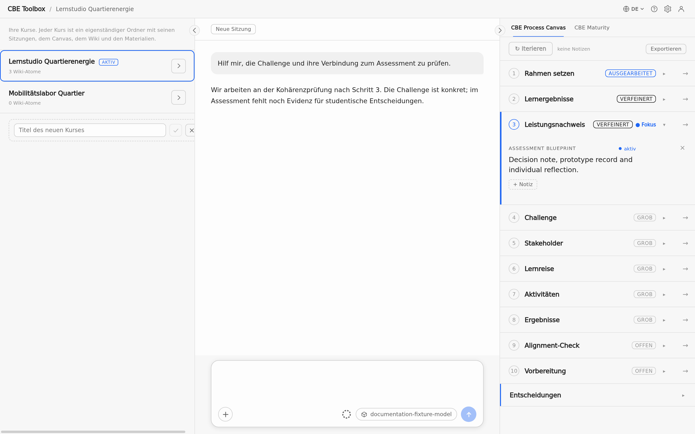

_Die Kursliste zeigt den aktiven Course, einen weiteren Course und das Feld zum Erstellen._

<!-- topic:conversation-lifecycle -->

## Chats, New Session und Arbeit im Hintergrund

Ein Course kann gespeicherte Chats behalten. Setzen Sie den offenen Chat fort oder nehmen Sie in den Course-Details einen älteren Chat wieder auf. Zwischen Chats wechseln Sie im linken Seitenpanel. **New Session** startet einen frischen Gesprächskontext für denselben Course; Canvas, Schrittstand, Maturity-Einschätzung und der bisherige gespeicherte Chat bleiben erhalten.

<!-- ui:new-session -->

Wenn Sie während einer laufenden Antwort den Course wechseln, kann die Arbeit im Hintergrund weiterlaufen und bleibt an den ursprünglichen Course gebunden. Bei der Rückkehr sehen Sie die passende Antwort und den passenden Zustand. Das quadratische Stop-Steuerelement beendet die sichtbare laufende Antwort; bereits empfangener Text bleibt als gestoppt markiert. Bei einer abgeschnittenen Antwort werden Fortsetzen oder Wiederholen angeboten. Abgeschlossene Turns und Entwurfszustand werden an Turn-Grenzen gespeichert und überstehen einen Neustart der App.

<!-- ui:send-stop -->

<!-- screenshot:working-and-stop:default:desktop -->

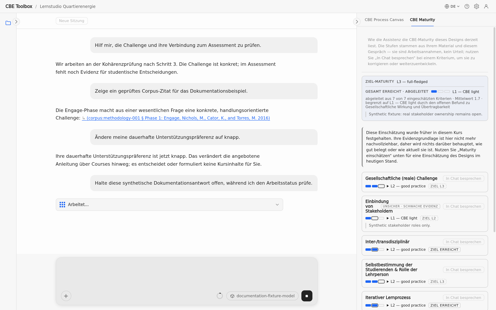

_Das Gespräch zeigt eine laufende Antwort und das Stop-Steuerelement im Eingabefeld._

<!-- topic:intent-sensitive-work -->

## Gestaltung, Übertragung und kritische Prüfung

Benennen Sie in Ihrer Anfrage die gewünschte Arbeit:

- **Gestaltung:** Nennen Sie Modul oder Gestaltungsentscheidung. Ohne eigenen Einstieg beginnt die Arbeit bei Ambition und Rahmen.
- **Übertragung:** Geben Sie die bestehende Lehre oder eine knappe Beschreibung mit und sagen Sie, was angepasst werden soll. Das vorhandene Material – nicht ein leerer Fragebogen – ist der Ausgangspunkt.
- **Kritische Prüfung:** Bitten Sie darum, Schwächen aufzudecken oder einen vorhandenen Entwurf einem Stresstest zu unterziehen. Fehlt der Entwurf, fragt die Toolbox danach, statt Befunde zu erfinden.

Sie können die Absicht während eines Chats ändern, ohne den Course zurückzusetzen oder aufgezeichnete Arbeit zu löschen.

<!-- topic:support-and-consent -->

## Gewünschte Unterstützung wählen

Der Assistent kann Sie einmal einladen, eine dauerhafte Unterstützung zu wählen: mehr schrittweise Anleitung, Zusammenarbeit an einem Entwurf oder knappe Rückmeldung. Diese Präferenz gilt über Courses und Neustarts hinweg, bis Sie sie ausdrücklich ändern oder löschen. Eine einmalige Bitte wie „Gib mir hier ein Beispiel“ gilt nur für diesen Moment. Die Präferenz ist von den Einschätzungen im Profile getrennt und sagt nichts über Ihre Kompetenz aus.

Eine Unterstützungspräferenz ist **keine Zustimmung, Inhalte für Ihren Course zu formulieren**. Erfahrung, Schwierigkeit, Schweigen, knappe Zeit oder eine Präferenz berechtigen den Assistenten nicht, eine Komponente Ihres Moduls zu schreiben. Im Gespräch können Sie die dauerhafte Präferenz ändern oder löschen lassen.

<!-- screenshot:support-preference:default:desktop -->

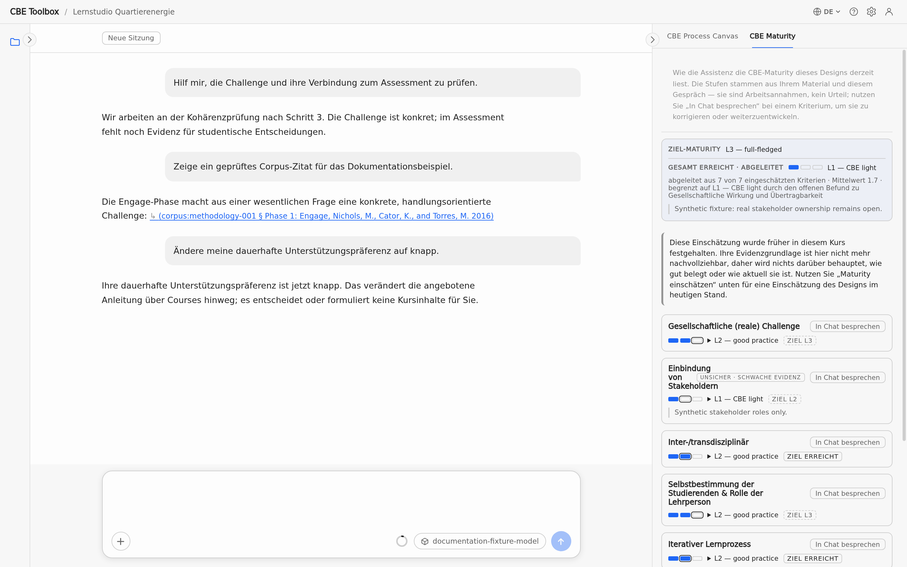

_Das Gespräch bestätigt die gewählte knappe Unterstützungspräferenz._

<!-- topic:iterative-formulation -->

## Formulierungshilfe lässt die Entscheidung bei Ihnen

Text für Ihr eigenes Modul darf der Assistent erst formulieren, nachdem Sie ausdrücklich darum gebeten oder ein konkretes Angebot angenommen haben. Danach arbeitet er schrittweise:

1. Er gibt Ihre Entscheidung und die aktuell bearbeitete Komponente wieder.
2. Er entwirft diese Komponente, nennt offene Lücken und kennzeichnet jede Annahme.
3. Sie korrigieren oder akzeptieren den Wortlaut.
4. Der Assistent verfeinert oder zeichnet den akzeptierten Teil auf.

Auch die Bitte um einen ganzen Entwurf beginnt bei der aktuellen Komponente, statt fehlende Entscheide stillschweigend zu erfinden. Akzeptierter Wortlaut klärt den gewünschten Text, nicht die benannten Lücken. Vorschläge ohne Grundlage in Ihrem Material bleiben gekennzeichnete Annahmen und werden nicht zu Tatsachen.

<!-- topic:canvas -->

## CBE Process Canvas

Der Canvas folgt zehn Gestaltungsschritten:

**1** Rahmen – **2** Lernziele – **3** Assessment – **4** Challenge – **5** Stakeholder – **6** Lernreise – **7** Aktivitäten – **8** Ergebnisse – **9** Alignment-Matrix – **10** Bereitschaft

Sie können dort beginnen, wo Ihre Arbeit steht; die Reihenfolge ist Orientierung und kein linear auszufüllendes Formular. Sobald die Schritte 1–3 abgeschlossen sind, prüft das Gespräch die Kohärenz von Challenge, Lernzielen und Assessment, bevor es vertiefende Arbeit vorschlägt.

Jeder Schritt hat einen Fokus und eine Tiefe: **offen**, **grob**, **verfeinert** oder **detailliert**. Karten halten vereinbarte Komponenten fest. Ein leeres Feld ist ein unbeantworteter Entscheid und kein automatisch zu behebender Mangel. Überarbeitungen aktualisieren die vorhandene Karte. Sie können eine Karte bewusst leeren und Anmerkungen im Gespräch klären. Der Export erzeugt deterministisches Markdown aus dem aufgezeichneten Zustand; er ist ein Entwurfsdokument und kein Diagnoseprotokoll.

<!-- screenshot:process-canvas:default:desktop -->

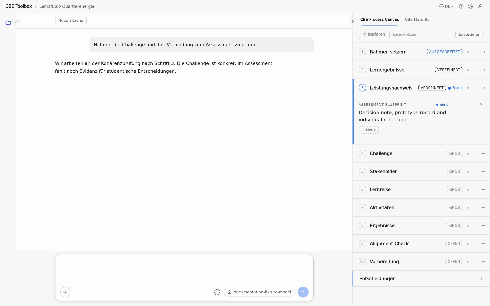

_Der Canvas zeigt zehn Schritte, den aktuellen Fokus und Karten mit unterschiedlichen Tiefen._

<!-- topic:maturity -->

## CBE Maturity

CBE Maturity zeigt, wie weit Ihr Modulentwurf die PIONEER-Kriterien für Challenge-Based Education derzeit erfüllt. Der Assistent schätzt jedes Kriterium anhand Ihres Materials und des Gesprächs ein. Diese Stufen sind Arbeitsannahmen und kein Urteil.

Der Kasten oben im Panel zeigt zwei Stufen:

- „Ziel-Maturity“ ist das Ambitionsniveau, das Sie für Ihr Modul festlegen.
- „Gesamt erreicht · abgeleitet“ ist die Stufe, die die App aus den aktuellen Stufen der einzelnen Kriterien berechnet.

Die erste Einschätzung erscheint, sobald die Schritte 1–3 des Canvas abgeschlossen sind und die Kohärenzprüfung etwas einzuschätzen hat. Solange wenig entschieden ist, wird die Einschätzung als vorläufig markiert, statt zu hoch auszufallen.

Die sieben PIONEER-Kriterien sind:

1. **Gesellschaftliche (reale) Challenge** – Offenheit und Bezug zu einem realen Anliegen;
2. **Einbindung von Stakeholdern** – von punktuellem Input bis zur Mitgestaltung;
3. **Inter-/transdisziplinär** – strukturelle Verbindung von akademischem und nichtakademischem Wissen;
4. **Selbstbestimmung der Studierenden & Rolle der Lehrperson** – Entscheidungen der Studierenden und Facilitation;
5. **Iterativer Lernprozess** – Testen, Feedback, Reflexion und Anpassung;
6. **Werteorientierung, Reflexion** – Ethik und gesellschaftliche Wirkung;
7. **Gesellschaftliche Wirkung und Übertragbarkeit** – Ergebnisse für relevante Gemeinschaften oder Handlungen.

Für jedes Kriterium zeigt das Panel die aktuelle Stufe und die Zielstufe, zum Beispiel „Ziel L3“, oder „Ziel erreicht“. Ein Kriterium kann als „unsicher · schwache Evidenz“ markiert sein, wenn wenig vorliegt. Ein offener Punkt, den Sie bewusst ungelöst lassen, kann ein Kriterium begrenzen („offener Befund · begrenzt dieses Kriterium“). Ändert sich der Entwurf später, kann eine Einschätzung veralten. Die Stufen im Panel können Sie nicht bearbeiten: Verwenden Sie „In Chat besprechen“ bei einem Kriterium oder fragen Sie im Gespräch, um die Einschätzung zu besprechen oder zu aktualisieren.

<!-- screenshot:maturity-reading:default:desktop -->

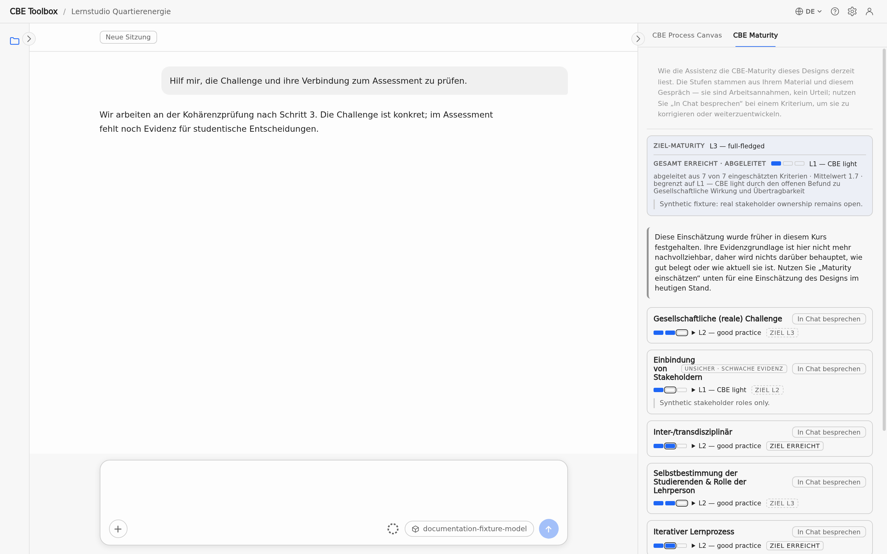

_Das Panel zeigt „Ziel-Maturity“, „Gesamt erreicht · abgeleitet“ und die Stufe jedes Kriteriums._

## Profil

Öffnen Sie Ihr Profil über das Personensymbol oben rechts im Anwendungsfenster, neben dem Zahnrad. Das Profil beschreibt Sie als dozierende Person: Ihren Namen, die gewünschte Anrede und fünf Einschätzungen zu Ihnen – Ihr Vorwissen zu problembasiertem Lernen und zu CBE, Ihre didaktische Haltung, Ihre Einstellung zu CBE und Ihre Lehrbelastung.

<!-- screenshot:profile:entry:desktop -->

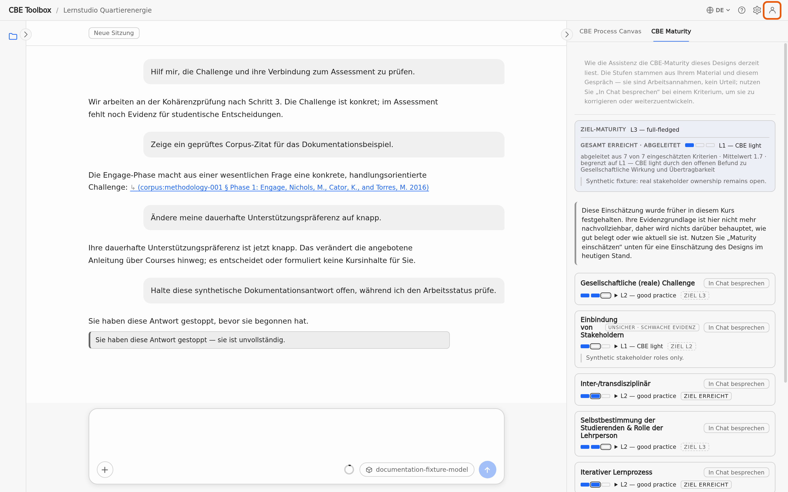

_Das hervorgehobene Personensymbol oben rechts öffnet Ihr Profil._

Diese Einschätzungen beeinflussen, wie die Toolbox mit Ihnen arbeitet, zum Beispiel wie viel sie erklärt und wie sie ihre Vorschläge zuschneidet. Die Toolbox füllt sie automatisch aus Ihren Gesprächen aus und zeigt, wie sicher jede Einschätzung ist. Sie können jede Einschätzung überschreiben, indem Sie einen anderen Wert wählen; sie ist dann als von Ihnen gesetzt markiert. Das Profil gilt für alle Ihre Courses.

<!-- screenshot:profile:pane:desktop -->

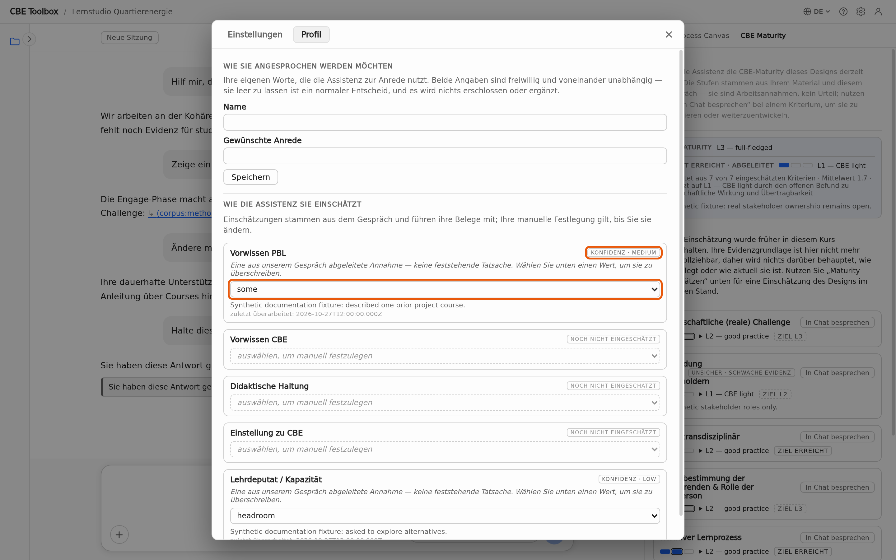

_Die Profilansicht: die Einschätzung der Toolbox mit ihrer Sicherheit (obere Hervorhebung) und die Auswahl, mit der Sie sie überschreiben (untere Hervorhebung). Die gezeigten Werte sind synthetischer Inhalt des Dokumentationsbeispiels._

<!-- topic:attachment-versus-wiki -->

## Anhang oder Course Wiki?

Sie können der Toolbox eigenes Material auf zwei Wegen geben:

- Ein **Anhang** (einmaliger Upload) ist für Material gedacht, das für Ihre nächste Nachricht wichtig ist, zum Beispiel ein Entwurf, zu dem Sie jetzt Rückmeldung möchten. Er wird nur für diese eine Nachricht gelesen.
- Das **Course Wiki** ist für Material gedacht, auf das Sie in diesem Course zurückkommen möchten, zum Beispiel eine bestehende Modulbeschreibung, einen Stundenplan oder Literatur. Die Toolbox macht aus jedem importierten Dokument kurze, durchsuchbare Notizen (die App nennt sie Atome) und kann in allen späteren Chats des Course darauf zurückgreifen.

<!-- screenshot:attachment-and-wiki:overview:desktop -->

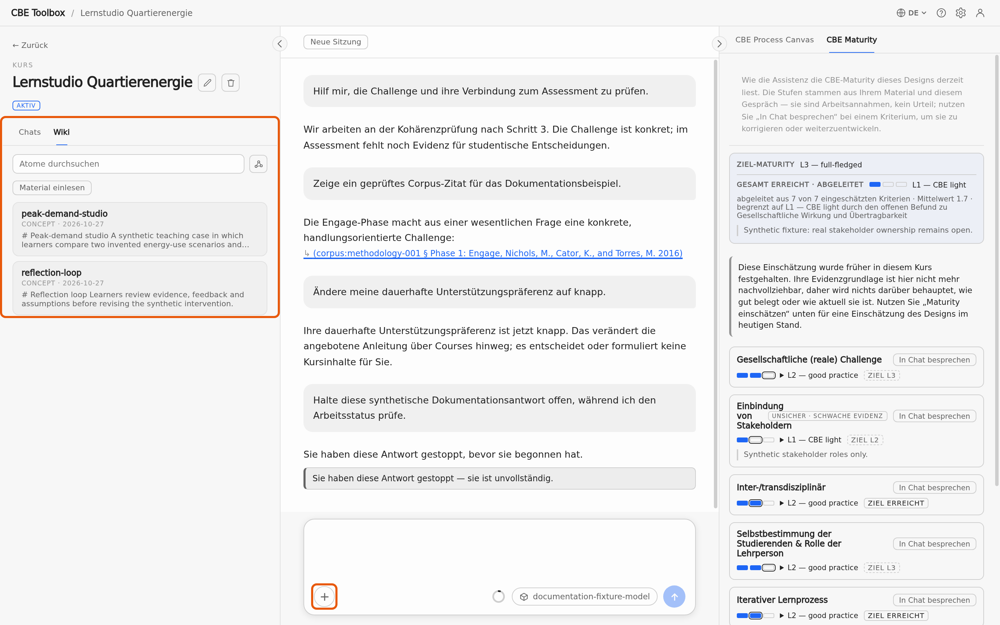

_Wo Sie welchen Weg finden: die Plus-Schaltfläche im Nachrichtenfeld für einen einmaligen Anhang (untere Hervorhebung) und den Wiki-Tab des Course im linken Panel (linke Hervorhebung)._

### Eine Datei an eine Nachricht anhängen

Wählen Sie die Plus-Schaltfläche unten links im Nachrichtenfeld. Ihr Menü bietet das Hochladen von Dateien als Anhang und die Gesprächshilfe. Eine angehängte Datei erscheint als entfernbares Element über dem Nachrichtenfeld und wird mit Ihrer nächsten Nachricht gesendet. Sie wird nicht ins Wiki aufgenommen.

<!-- ui:material-upload -->

<!-- screenshot:composer-plus-menu:default:desktop -->

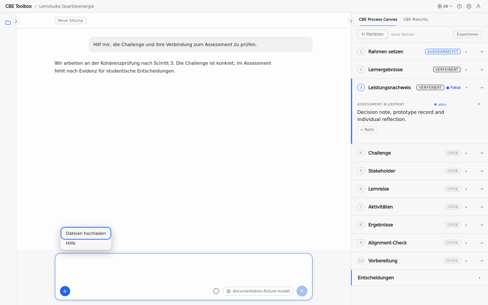

_Das Menü hinter der Plus-Schaltfläche im Nachrichtenfeld bietet Datei-Upload und Gesprächshilfe._

<!-- formats:SUPPORTED_EXTENSIONS -->

Anhänge und Wiki-Importe akzeptieren dieselben Dateitypen: **PDF, DOCX, PPTX, XLSX, TXT, MD und CSV**. CSV bleibt Text. Bei XLSX bleiben Blattnamen, Zellpositionen, leere Zellen, die gespeicherten Ergebnisse von Formeln, Datumswerte (im ISO-Format) und verbundene Zellen erhalten. Alte oder makrofähige Excel-Formate (`.xls`, `.xlsb`, `.xlsm`) werden namentlich abgelehnt; speichern Sie eine Kopie als `.xlsx` und versuchen Sie es erneut.

<!-- topic:wiki-ingestion -->

## Material ins Wiki importieren

Öffnen Sie den Course im linken Seitenpanel und wechseln Sie zu seinem Wiki-Tab. Mit der Import-Schaltfläche unter dem Suchfeld wählen Sie Dateien von Ihrem Computer aus. Jedes Dokument zeigt seinen eigenen Fortschritt; scheitert ein Dokument, werden die anderen trotzdem importiert. Sie können einen Import abbrechen und erneut versuchen. Wechseln Sie währenddessen zu einem anderen Course, läuft der Import für den Course weiter, in dem Sie ihn gestartet haben. Ist er abgeschlossen, erscheinen die neuen Notizen in der Wiki-Liste. Es werden nur lokale Dateien akzeptiert; Webseiten, Feeds und andere Netzwerkquellen werden nicht abgerufen.

<!-- screenshot:wiki-ingestion-progress:default:desktop -->

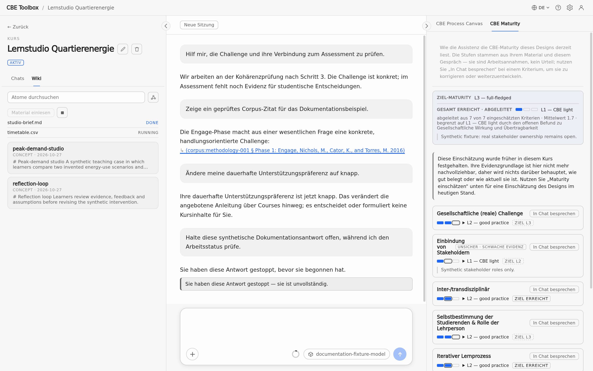

_Das Wiki zeigt getrennte Fortschrittszeilen für ein abgeschlossenes und ein laufendes Dokument._

<!-- topic:wiki-use -->

## Wiki durchsuchen

Tippen Sie im Wiki-Tab des Course in das Suchfeld, um die Notizen nach Wörtern aus Überschriften, Metadaten oder Text des eingelesenen Materials zu filtern. Öffnen Sie eine Notiz, um ihre Quellangaben und verwandte Notizen zu sehen. Die Schaltfläche direkt rechts neben dem Suchfeld wechselt zwischen der Liste und der Graphansicht, die zeigt, wie die Notizen verknüpft sind. Beide Ansichten zeigen dieselben Notizen.

<!-- screenshot:wiki-browser:list:desktop -->

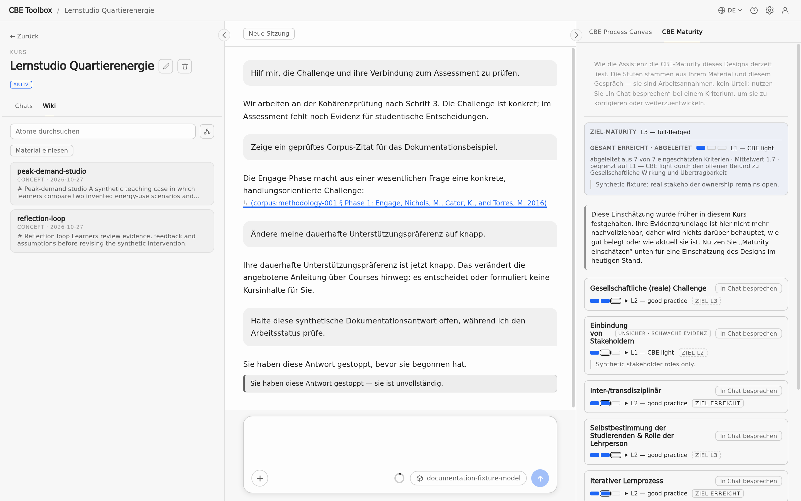

_Die Listenansicht zeigt durchsuchbare Wiki-Notizen und ihre Vorschau._

<!-- screenshot:wiki-browser:graph:desktop -->

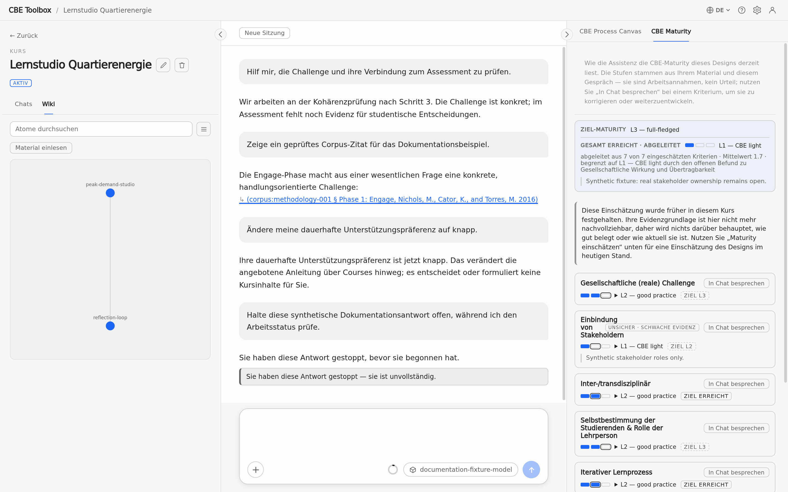

_Die Graphansicht zeigt die Verbindungen zwischen denselben Wiki-Notizen._

<!-- topic:sources-and-citations -->

## Quellen und Zitate

Der kuratierte Corpus enthält CBE-Methodik; das Course Wiki enthält Ihr wiederverwendbares Kursmaterial. Liegt dieselbe Quelle in beiden vor, hat das Wiki des aktiven Course Vorrang. Ein Zitat erscheint in der Antwort des Assistenten als unterstrichener Link in Klammern, zum Beispiel „(corpus:methodology-001 § …)“ für den Corpus oder „(wiki:…)“ für Ihr Course Wiki. Wählen Sie es aus, um die Quelle in einem Fenster über der App zu öffnen: Es zeigt Titel und Angaben des Dokuments sowie den zitierten Text, sodass Sie die Quelle prüfen können. Schliessen Sie das Fenster, um zum Gespräch zurückzukehren. Ein Corpus-Zitat wird gegen den Corpus geprüft; ein Wiki-Zitat wird über den Index dieses Course aufgelöst.

<!-- screenshot:citation-source:default:desktop -->

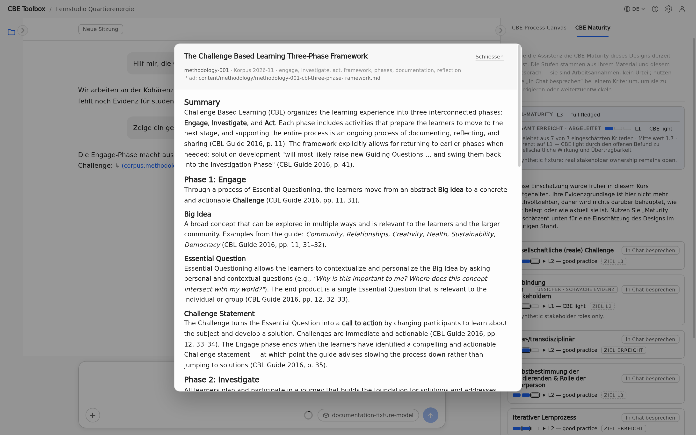

_Die Quellenansicht zeigt die zitierte Passage und die Angaben zum Dokument._

Der Assistent kann einen Arbeitsvorschlag machen, wenn die verfügbaren Quellen eine Aussage nicht belegen. Der Vorschlag muss klar als ungeprüft gekennzeichnet sein.

<!-- topic:settings -->

## Oberflächensprache und Settings

### Oberflächensprache

Die Sprache der Menüs und Beschriftungen der App ändern Sie mit der Sprachauswahl (Globussymbol) oben rechts im Anwendungsfenster. Die Änderung gilt sofort; sie bestimmt nicht die Sprache Ihrer Lehrinhalte.

<!-- ui:header-interface-language -->

<!-- screenshot:language-selector:default:desktop -->

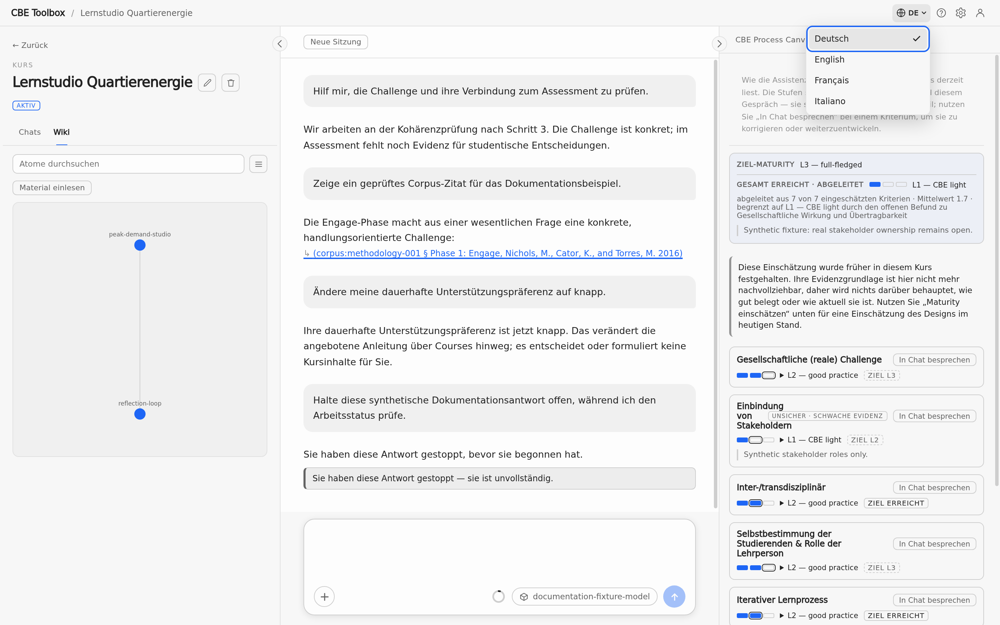

_Die geöffnete Auswahl zeigt die verfügbaren Oberflächensprachen._

### Settings öffnen

Öffnen Sie Settings über das Zahnrad oben rechts im Anwendungsfenster oder auf macOS mit `Cmd+,` und unter Windows/Linux mit `Ctrl+,`. Wie Sie die Modellverbindung einrichten, beschreibt [Modell verbinden](installation-and-local-it.md#model-connection). `F1` öffnet die Hilfe.

<!-- ui:settings-gear -->
<!-- ui:settings-panel -->
