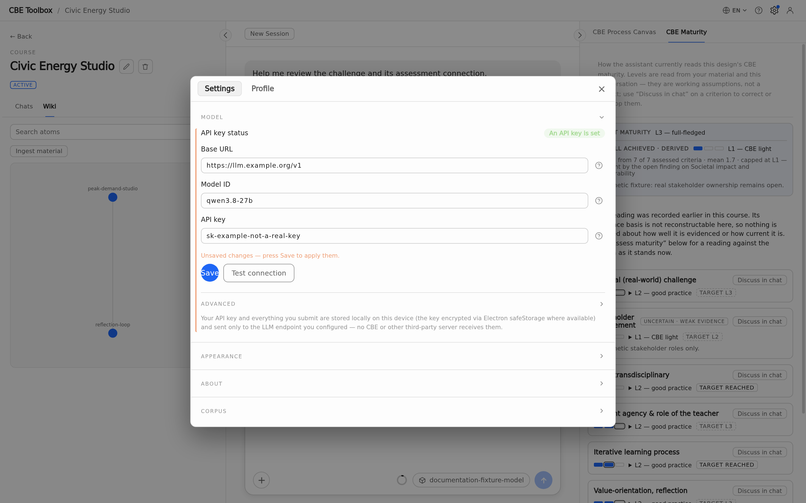

# Installation

Instructions for **CBE Toolbox 0.1.21 / CBE Skill 0.4.2**.

<a id="what-is-cbe-toolbox"></a>

## What is the CBE Toolbox?

The CBE Toolbox is an AI-supported application that helps lecturers create courses and modules in line with the Challenge-Based Education (CBE) didactics as defined in PIONEER. It guides lecturers through a structured creation process while considering their specific goals, backgrounds and context. At the heart of the application is an AI-powered chatbot enriched with expert information on CBE provided by the PIONEER consortium.

A core design principle of the Toolbox is to guide lecturers on where they invest cognitive effort while creating a CBE module, rather than taking over that effort. It does not provide ready-made solutions, but instead prompts lecturers to reflect on design decisions and develop their own solutions. Using the Toolbox may consequently require more active engagement than a standard AI chat interface. This is intentional: it enables lecturers to remain in charge and build expertise on CBE.

Detailed technical instructions follow below and in the code repository. In brief, the application is “Bring-Your-Own-AI”: users can (and need to) configure their own AI endpoint. User prompts are sent to this endpoint and may include information about the user and context gathered from conversations. Users should therefore consider the data-processing and privacy conditions of their chosen AI provider; see [Privacy, data and storage](privacy-data-storage.md). Other than the prompts, information is stored locally on the user's device.

The application can be downloaded as an installable file for Windows, macOS or Linux. Mobile operating systems such as Android or iOS are not currently supported (we expect module planning not to be done on phones in most cases). A cloud or web option is also not currently available. If installation of the application is prohibited by organisational security policies, IT departments can build and distribute their own, security-reviewed version. For this purpose, the source code is available under a permissive licence, which also allows modifications and contributions.

<a id="local-it"></a>

<!-- topic:local-it -->

## Dissemination for IT departments

IT departments are the primary distribution channel for the CBE Toolbox: they make the application available to lecturers, for example through the institution's software portal, and they provide the access credentials (API key) for an AI model.

### Build the application

The Virtuelle Akademie repository at [https://github.com/virtuelleakademie/cbe-toolbox](https://github.com/virtuelleakademie/cbe-toolbox) is the buildable generated source mirror: the sanitized source of the CBE Toolbox and the community's entry point for contributions through issues. Use Node.js **22.19 or newer** and the npm that ships with it.

Official downloads, including the signed and notarized macOS release, remain on the existing public [CBE Toolbox download page](https://cbe-toolbox.pages.dev/#download). Official GitHub releases, release automation, OTA publication and Cloudflare operations have not moved to the source mirror. Application updates and release ownership stay with the canonical project.

On Linux or macOS, clone and verify the mirror:

```sh
git clone https://github.com/virtuelleakademie/cbe-toolbox
cd cbe-toolbox
npm ci
npm run build
npm test
```

Create the installer on the target platform:

- macOS: `npm run dist:mac --workspace packages/app`
- Windows: `npm run dist:win --workspace packages/app`
- Linux: `npm run dist:linux --workspace packages/app`
- Checksums: `npm run checksums --workspace packages/app`

The output is written to `packages/app/release/`.

The public GitHub Actions workflow never passes `CBE_DEFAULT_LLM_API_KEY`, so public tag and manual builds start without a preconfigured key and show the one-time BYO-provider setup. The packaging script still supports a separately controlled opt-in build: if an operator explicitly supplies the variable outside the public workflow, the key becomes a first-run default. If the variable is absent or blank, the script removes any stale generated default before packaging. Users can still edit or remove the connection in the settings overlay. The optional default endpoint and model are defined in `packages/app/src/main/default-connection.ts`.

### Build and verify a Windows installer

For Windows, the supported path uses two platforms and one exact commit:

- **Linux, a Linux VM or WSL** runs the complete code verification: clean install, build and the full test suite.
- **Native Windows** compiles the application, packages the NSIS installer and records its checksum.
- **A clean Windows VM or device** installs that exact installer, starts it and runs bounded smoke checks.

The full test suite is not a supported gate on native Windows. Do not run it there in place of the Linux run, and do not accept red tests from any run: a red test on the supported Linux run is a failure and should be reported as an issue in the source mirror.

#### 1. Full code verification on Linux, a Linux VM or WSL

Choose the commit to build (normally the head of `main`), paste its full SHA into the first line and use the same SHA on both machines. Under WSL, clone into the Linux filesystem (for example `~/src`), not under `/mnt/c`: the Windows-drive mount brings back the Windows file semantics the suite does not support and is much slower.

```sh
COMMIT=PASTE-THE-FULL-COMMIT-SHA
mkdir -p ~/src && cd ~/src
git clone https://github.com/virtuelleakademie/cbe-toolbox
cd cbe-toolbox
git checkout --detach "$COMMIT"
git rev-parse HEAD
sha256sum package-lock.json
node --version
npm --version
npm ci
npm run build
npm test
```

Every test must pass. `npm run verify:mirror` runs the same lane the release runs for the mirror (build, tests, lint and generated-file freshness). The Electron layout tests run only where `xvfb-run` and Electron's system libraries are installed and are skipped otherwise.

#### 2. Compile and package on native Windows

Install Git for Windows and Node.js 22.19 or newer (x64). In PowerShell, use the identical commit:

```powershell
$Commit = "PASTE-THE-FULL-COMMIT-SHA"
git clone https://github.com/virtuelleakademie/cbe-toolbox C:\src\cbe-toolbox
cd C:\src\cbe-toolbox
git checkout --detach $Commit
git rev-parse HEAD
(Get-FileHash package-lock.json -Algorithm SHA256).Hash.ToLower()
node --version
npm --version
npm ci
npm run build
Remove-Item Env:CBE_DEFAULT_LLM_API_KEY -ErrorAction SilentlyContinue
$env:CSC_IDENTITY_AUTO_DISCOVERY = "false"
npm run dist:win --workspace packages/app
npm run checksums --workspace packages/app
Get-Content packages\app\release\SHA256SUMS.txt
```

The installer is written to `packages\app\release\CBE-Toolbox-<version>-x64.exe`, next to `SHA256SUMS.txt`. No signing certificate, signing credential, release token or default LLM secret is needed: the result is an unsigned installer without a preconfigured model key, so the first start shows the one-time provider setup. Your installer is not expected to be byte-identical to the official release asset; its checksum binds the file you built to the file you install.

#### 3. Install and smoke-check on a clean Windows VM or device

1. Copy the EXE and `SHA256SUMS.txt` to a Windows VM or device without a previous CBE Toolbox installation.
2. Verify the checksum with `Get-FileHash .\CBE-Toolbox-*-x64.exe -Algorithm SHA256`. It must match the line for that file in `SHA256SUMS.txt`.
3. Run the installer. A per-user installation needs no administrator rights. Because the installer is unsigned, SmartScreen may warn; choose **More info** → **Run anyway**, or apply your institution's allow-listing.
4. Start CBE Toolbox from the Start menu. The first start shows the one-time provider setup.
5. Enter your institution's endpoint, model ID and key, save, and use the connection test in the same settings group. Send one short chat message and confirm that an answer arrives.
6. Close and restart the application; the saved connection is still there.
7. Optionally uninstall through the Windows list of installed apps and confirm the program is removed.

These checks prove that this installer installs, starts and reaches your model service on Windows. They do not replace the Linux code verification, and the Linux run does not prove the installer.

#### 4. Compare the records

Keep one record per build and compare it across both machines:

| Item                                       | Expected                                                |
| ------------------------------------------ | ------------------------------------------------------- |
| Commit SHA (`git rev-parse HEAD`)          | identical on Linux and Windows                          |
| `package-lock.json` SHA-256                | identical on Linux and Windows                          |
| `sourceCommit` in `MIRROR_PROVENANCE.json` | identical (it follows from the commit)                  |
| Node.js and npm versions                   | 22.19 or newer on both; ideally the same version        |
| Installer SHA-256                          | identical on the build machine and on the target device |

If the commit or the lockfile hash differs, the Linux test result does not cover the installer; rebuild from the matching commit.

#### Why two platforms

The official release pipeline works the same way: its full test suite runs on Linux, and the native Windows job installs, builds and packages the identical commit and publishes the installer checksum. The source mirror's snapshots are validated the same way, and no record claims a native Windows test-suite pass.

The test suite was written for and is run on Linux. On native Windows it used to fail for reasons in the tests' own assumptions rather than in the application: POSIX file modes and permissions, symbolic links, `/` path separators and locale-dependent output. The application defects found while investigating those failures, line endings on checkout and a file flush during Skill/corpus activation, are fixed, and host-independent regression tests for them run in the Linux suite. Native Windows `npm test` is therefore not part of the evidence in either direction: the two green runs above are.

### Provide the model service

CBE Toolbox follows a bring-your-own-provider model. The institution supplies either its own GPU-backed inference service or an approved external provider.

Provide users with:

- an OpenAI-compatible HTTPS base URL;
- a process for obtaining an API key;
- the model IDs available to them;
- any supported context-window and reasoning settings;
- the provider's privacy, retention, training and regional terms.

Client devices need outbound HTTPS access to that endpoint. The app uses the provider's model-list and chat-completions routes. It does not require an inbound port on the lecturer's device.

Review local storage and backups under [What is stored locally](privacy-data-storage.md#local-storage). Provider keys must not be placed in shared scripts, tickets or documentation.

<a id="install-current-build"></a>

<!-- topic:installation-current-build -->

## Installation for end users

> [!CAUTION]
> The instructions describe installation on standard end-user devices. Institutionally managed devices may restrict installation. In this case, end users need to contact their local IT department. The providers of CBE Toolbox do not provide individual installation support.

If you belong to an institution of the PIONEER Alliance, first check your institution's software portal (for example the company portal for managed devices) to see whether CBE Toolbox is already available there. If it is not, contact your IT department and ask for access credentials for an AI model (LLM).

To install it yourself, download the current public release from the [CBE Toolbox download page](https://cbe-toolbox.pages.dev/#download). Choose the installer for your operating system.

The macOS release is signed with an Apple Developer ID and notarized by Apple. The Windows installer remains unsigned, so Edge or SmartScreen may still show a warning. The Linux AppImage is unsigned by design; verify its checksum before running it.

### macOS

1. Download the Apple Silicon (`arm64`) DMG.
2. Open the DMG and drag **CBE Toolbox** into **Applications**.
3. Open **CBE Toolbox** from Applications. No Terminal command or Gatekeeper bypass is required.

### Windows

1. Download the EXE installer.
2. If Edge blocks the download, open its download menu and choose **Keep** → **Show more** → **Keep anyway**.
3. Right-click the downloaded file, open **Properties**, select **Unblock** if shown, and choose **OK**.
4. Run the installer. Installing for the current user is sufficient and does not require administrator rights.
5. If SmartScreen appears, choose **More info** → **Run anyway**. If your institution removes that option, contact local IT.

### Linux

1. Download the AppImage.
2. Make it executable and start it:

   ```sh
   chmod +x CBE-Toolbox-*.AppImage
   ./CBE-Toolbox-*.AppImage
   ```

### Verify the download

The build page also provides `SHA256SUMS.txt`. Compare the checksum before opening the installer:

- macOS: `shasum -a 256 CBE-Toolbox-*.dmg`
- Windows PowerShell: `Get-FileHash CBE-Toolbox-*.exe -Algorithm SHA256`
- Linux: `sha256sum CBE-Toolbox-*.AppImage`

The printed checksum must match the line for your file in `SHA256SUMS.txt`.

<a id="model-connection"></a>

<!-- topic:model-connection -->

## Connect a model

CBE Toolbox needs access to an AI model. Public releases contain no default API key. A fresh installation therefore shows the existing one-time provider setup; your IT department may supply the connection details, or you may use your own OpenAI-compatible provider. A separately controlled institutional build can still be packaged with a first-run default, but the public release workflow does not do this.

Messages and the relevant material for each request are sent to the configured provider. Check the provider's privacy and retention terms before adding course material. See [Local persistence versus provider transfer](privacy-data-storage.md#provider-data-flow).

To configure the connection:

1. Open the settings overlay from the settings gear at the top-right of the application window.
2. Open the group that contains the endpoint, model ID and key.
3. Enter the base URL, model ID and API key supplied by your IT department or provider.
4. Save the connection, then use the test control in the same group. The test checks the saved connection.
5. Go back to the chat window and try a chat. If, instead of a response by the model, you see an error message, check the troubleshooting section [The model is not configured or the connection test fails](troubleshooting-and-reference.md#model-connection-fails).

<!-- screenshot:model-settings:example-values:desktop -->



_The model group with example values entered but not yet saved. The base URL and API key are invented examples, not a real endpoint or key; use the values from your IT department or provider._

An update leaves the existing local provider configuration and encrypted key unchanged. In particular, an installation that previously ran v0.1.17 may retain the credential stored there until the provider owner separately revokes that key; v0.1.18 does not erase or migrate it because the app cannot reliably distinguish an earlier bundled credential from one entered by the lecturer.

Do not paste an API key into a Chat, screenshot or support ticket.

<!-- ui:settings-gear -->
<!-- ui:settings-panel -->
