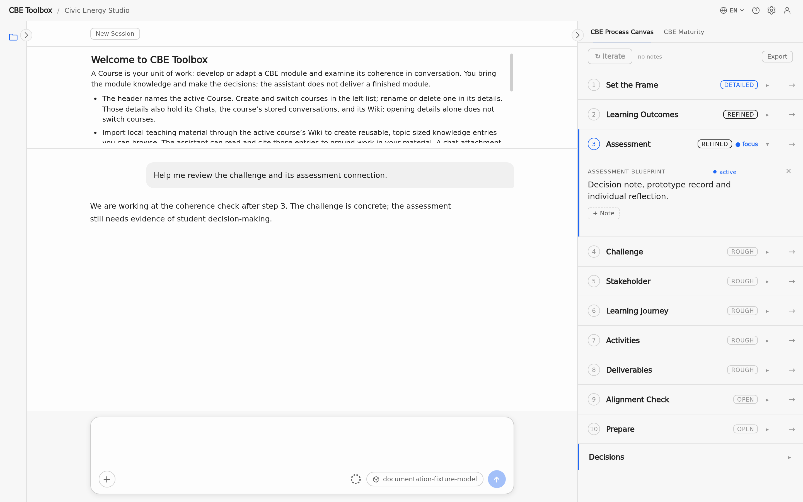
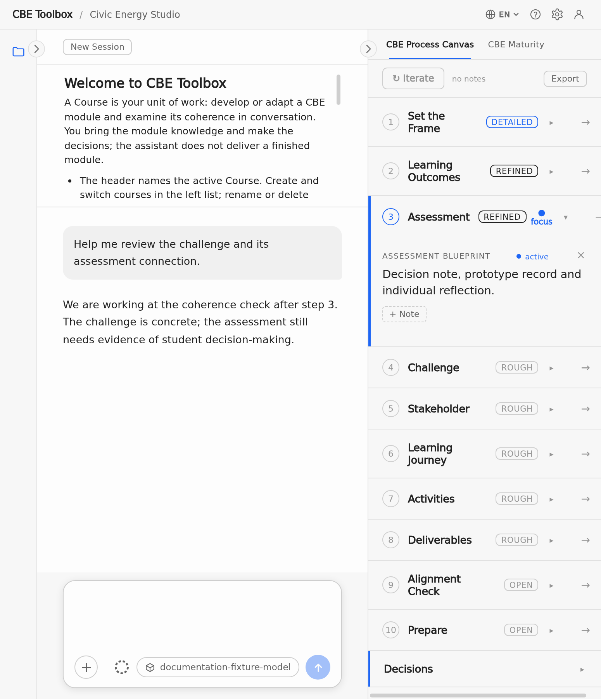

# Quick Start

Create a Course and send your first useful request.

<!-- topic:first-course-and-request -->

## From first launch to useful work

1. **Install the current build.** Download it from [Installation for end users](installation-and-local-it.md#install-current-build).

2. **Check the model connection.** If your institution has not configured it, follow [Connect a model](installation-and-local-it.md#model-connection).
   <!-- ui:settings-panel -->

3. **Create or select a Course.** Open the course list through the course name at the top. Create a Course for the module you want to design, transfer or review, or select an existing Course.
   <!-- ui:header-course-name -->

4. **Describe the work.** Write one concrete request, for example:
   - “Help me adapt this seminar to CBE. Start with the assessment challenge.”
   - “Critically review the challenge in my recorded design.”

5. **Add relevant material if needed.** Paste a short description or attach a local file. Import material into the Course Wiki when you want to reuse it in later Chats. See [Attachment or course Wiki?](user-guide.md#attachment-versus-wiki).
   <!-- ui:material-upload -->

6. **Send the request.** Enter sends; Shift+Enter adds a line. Course data remains on this installation. The configured model provider receives the material needed to answer. See [Local persistence versus provider transfer](privacy-data-storage.md#provider-data-flow).
   <!-- ui:send-stop -->

<!-- screenshot:first-use-orientation:default:desktop -->

_The overview shows the main areas of the workspace and the first actions._

<!-- screenshot:first-use-orientation:default:narrow -->

_The narrow view shows the overview above the conversation and message field._

## If you cannot continue

- Model connection: [Connect a model](installation-and-local-it.md#model-connection)
- App or answer error: [Common symptoms and safe recovery](troubleshooting-and-reference.md#troubleshooting)
- Questions about material and privacy: [Privacy, data and storage](privacy-data-storage.md)
