# Lecturer User Guide

How to design, transfer and review CBE modules with the Toolbox.

<!-- topic:purpose-and-limits -->

## Purpose and limits

Use the Toolbox to **design a CBE module, transfer existing teaching into CBE, or critically review a design**. It keeps decisions visible, checks coherence and provides CBE methodology. You remain responsible for subject expertise, institutional decisions and the final module.

<!-- topic:workspace-orientation -->

## Know the workspace

The active **Course** owns its Chats, recorded design and Wiki. The left side leads to Courses and their stored Chats/Wiki. The centre is the conversation. The right side contains **CBE Process Canvas**, the recorded design, and **CBE Maturity**, a working assessment of that design. The person and gear at the top right open Profile and Settings for the whole app. The header course name always tells you which Course is active.

<!-- ui:header-course-name -->

Keep the surfaces distinct:

- the **conversation** carries reasoning, questions and decisions;
- **CBE Process Canvas** records settled design components;
- **CBE Maturity** assesses the recorded design against the seven PIONEER maturity criteria;
- the **course Wiki** holds reusable material you imported for this Course;
- the **corpus** is curated CBE methodology shipped with the Toolbox.

<!-- screenshot:workspace-orientation:default:desktop -->

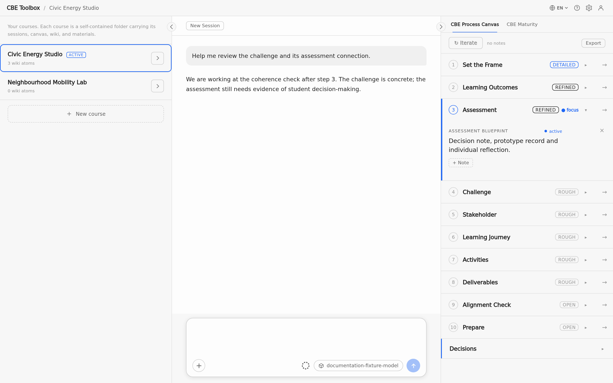

_The workspace shows Courses on the left, the conversation in the centre and CBE Process Canvas on the right._

<!-- screenshot:workspace-orientation:default:narrow -->

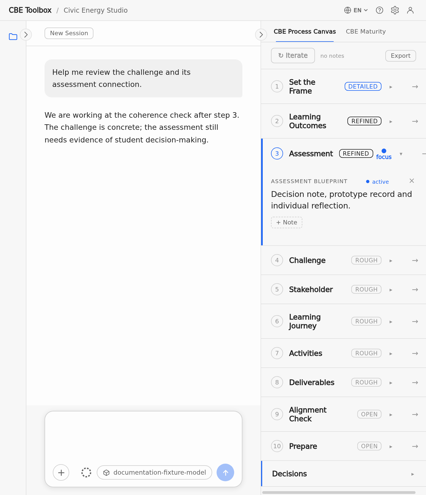

_The narrow view shows the conversation between the collapsed side panels._

<!-- topic:course-lifecycle -->

## Courses

Open the course list through the course name at the top. Create a Course, select another Course, or open its details to rename or delete it. Switching changes the conversation, Canvas, Maturity and Wiki together. Deleting moves the Course folder to the operating system trash. Running answers and Wiki imports must finish before deletion.

<!-- ui:header-course-name -->

<!-- screenshot:course-management:create-switch:desktop -->

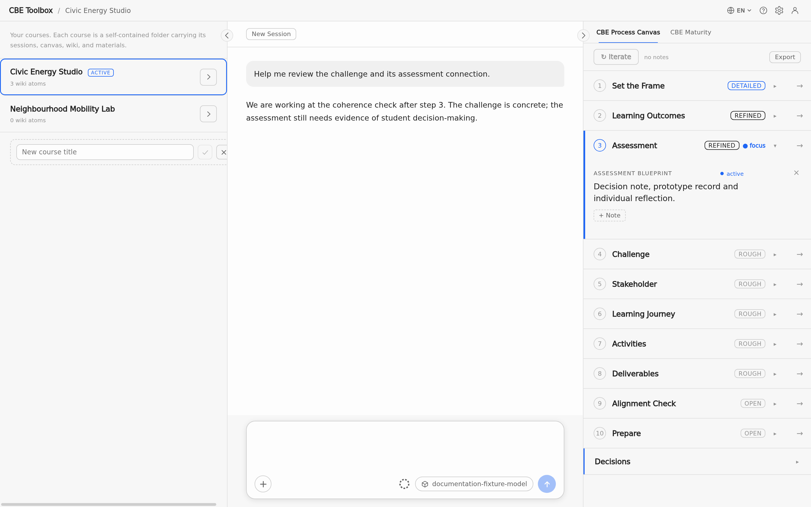

_The course list shows the active Course, another Course and the field for creating a Course._

<!-- topic:conversation-lifecycle -->

## Chats, New Session and background work

A Course can retain stored Chats. Continue the open Chat, or resume an older stored Chat from that Course's detail view. You can switch between Chats in the left side panel. **New Session** starts a fresh conversational context for the same Course; it does not erase the Canvas, step coverage, Maturity assessment or previous stored Chat.

<!-- ui:new-session -->

If you switch Courses while an answer is running, that work may continue in the background and remains bound to its original Course. Returning shows the matching answer and state. The square Stop control ends the visible running answer; text already received remains and is marked as stopped. A cut-off response offers Continue or Retry. Completed turns and design state are persisted at turn boundaries and survive an app restart.

<!-- ui:send-stop -->

<!-- screenshot:working-and-stop:default:desktop -->

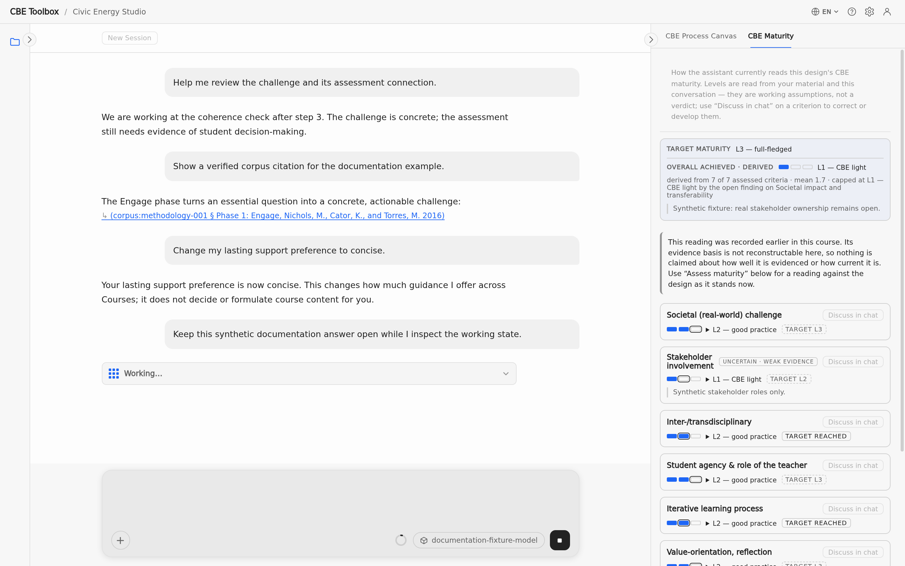

_The conversation shows an answer in progress and the Stop control in the message field._

<!-- topic:intent-sensitive-work -->

## Design, transfer and critical review

State the intended work in your request:

- **Design:** name the module or design decision you want to develop. With no chosen entry point, the work starts from ambition and framing.
- **Transfer:** provide the existing teaching or a concise description and say what should be adapted. The existing material—not a blank questionnaire—is the starting point.
- **Critical review:** ask to expose weaknesses or stress-test an available design. The review starts from that design; if it is missing, the Toolbox asks for it rather than inventing findings.

You can redirect the intent during a Chat without resetting the Course or erasing recorded work.

<!-- topic:support-and-consent -->

## Choose the support you want

The assistant may invite you once to choose lasting support: more step-by-step guidance, collaboration on a draft, or concise feedback. The preference applies across Courses and restarts until you explicitly change or clear it. A one-off request such as “give me one example here” changes only that moment. The preference is separate from the Profile's estimates and says nothing about your competence.

A support preference is **not consent to formulate course content**. Neither experience, difficulty, silence, limited time nor a preference authorises the assistant to write a component for your module. You can ask to change or clear the lasting preference in the conversation.

<!-- screenshot:support-preference:default:desktop -->

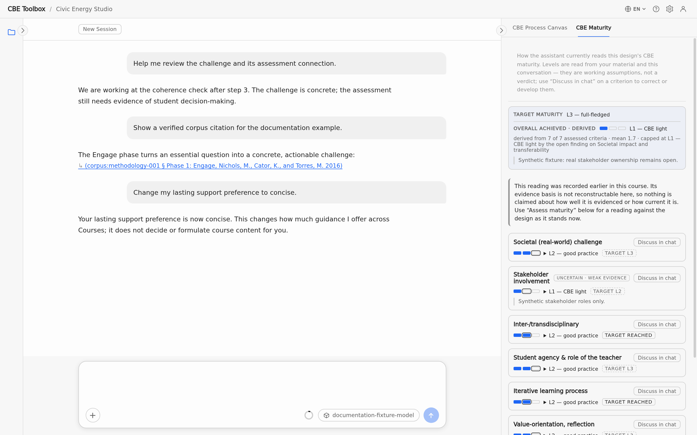

_The conversation confirms the selected concise support preference._

<!-- topic:iterative-formulation -->

## Formulation help remains your decision

The assistant may formulate text for your own module only after you explicitly ask for it or accept a specific offer. It then works step by step:

1. it restates your decision and the component currently being drafted;
2. it drafts that component, names open gaps and labels any assumption;
3. you correct or accept the wording;
4. the assistant refines or records the accepted part.

A request for a whole design still starts with the current component rather than silently inventing every missing decision. Accepting wording settles the requested text; it does not settle named gaps. Suggestions without support in your material remain labelled assumptions, not facts.

<!-- topic:canvas -->

## CBE Process Canvas

The Canvas follows ten design steps:

**1** frame – **2** learning outcomes – **3** assessment – **4** challenge – **5** stakeholders – **6** learning journey – **7** activities – **8** deliverables – **9** alignment matrix – **10** readiness

You may start where your work is; the order is guidance, not a form you must complete linearly. Once steps 1–3 are completed, the conversation checks that challenge, outcomes and assessment cohere before it proposes deeper work.

Each step has a focus and a depth: **open**, **rough**, **refined** or **detailed**. Cards hold settled components. An empty field is an unanswered decision, not a defect to fill automatically. Revisions update the existing card. You can clear a card deliberately and discuss annotations through the conversation. Export produces deterministic Markdown from the recorded host state; it is a design document, not a diagnostic log.

<!-- screenshot:process-canvas:default:desktop -->

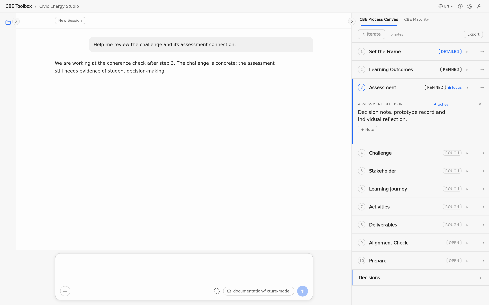

_The Canvas shows ten steps, the current focus and cards at different depths._

<!-- topic:maturity -->

## CBE Maturity

CBE Maturity shows how far your module design currently meets the PIONEER criteria for Challenge-Based Education. The assistant assesses each criterion from your material and the conversation. These levels are working assumptions, not a verdict.

The box at the top of the panel shows two levels:

- “Target maturity” is the level of ambition you set for your module.
- “Overall achieved · derived” is the level the app calculates from the current levels of the individual criteria.

The first assessment appears once steps 1–3 of the Canvas are completed and the coherence check has something to assess. While little has been decided, the assessment is marked as provisional rather than rated too high.

The seven PIONEER criteria are:

1. **Societal (real-world) challenge** — openness and connection to a real issue;
2. **Stakeholder involvement** — from occasional input to co-creation;
3. **Inter-/transdisciplinary** — structural integration of academic and non-academic knowledge;
4. **Student agency & role of the teacher** — student decisions and facilitation;
5. **Iterative learning process** — testing, feedback, reflection and adaptation;
6. **Value-orientation, reflection** — ethics and societal impact;
7. **Societal impact and transferability** — outcomes reaching relevant communities or action.

For each criterion the panel shows its current level and its target level, for example “target L3”, or “target reached”. A criterion can be marked “uncertain · weak evidence” when there is little to go on. An open point you chose to leave unresolved can limit a criterion (“open finding · caps this criterion”). When the design changes later, an assessment can become outdated (stale). You cannot edit the levels in the panel: use “Discuss in chat” on a criterion, or ask in the conversation, to discuss or update the assessment.

<!-- screenshot:maturity-reading:default:desktop -->

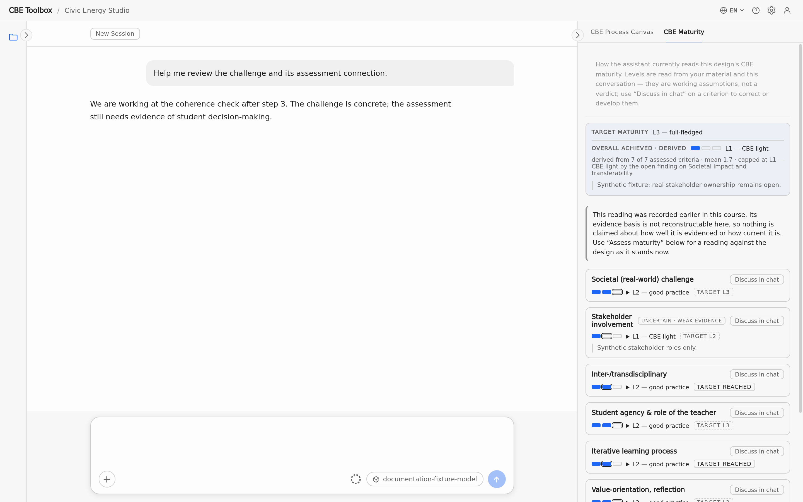

_The panel shows “Target maturity”, “Overall achieved · derived” and the level of each criterion._

## Profile

Open your Profile with the person icon at the top right of the application window, next to the settings gear. The Profile describes you as a lecturer: your name and how you would like to be addressed, and five estimates about you — your prior knowledge of problem-based learning and of CBE, your didactic stance, your attitude toward CBE and your teaching load.

<!-- screenshot:profile:entry:desktop -->

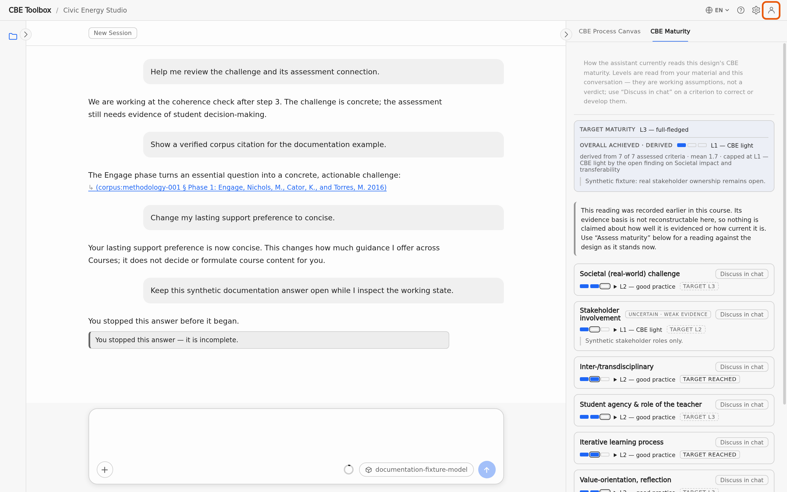

_The highlighted person icon at the top right opens your Profile._

These estimates influence how the Toolbox works with you, for example how much it explains and how it pitches its suggestions. The Toolbox fills them in automatically from your conversations and shows how confident each estimate is. You can override any estimate by choosing a different value; it is then marked as set by you. The Profile applies to all your Courses.

<!-- screenshot:profile:pane:desktop -->

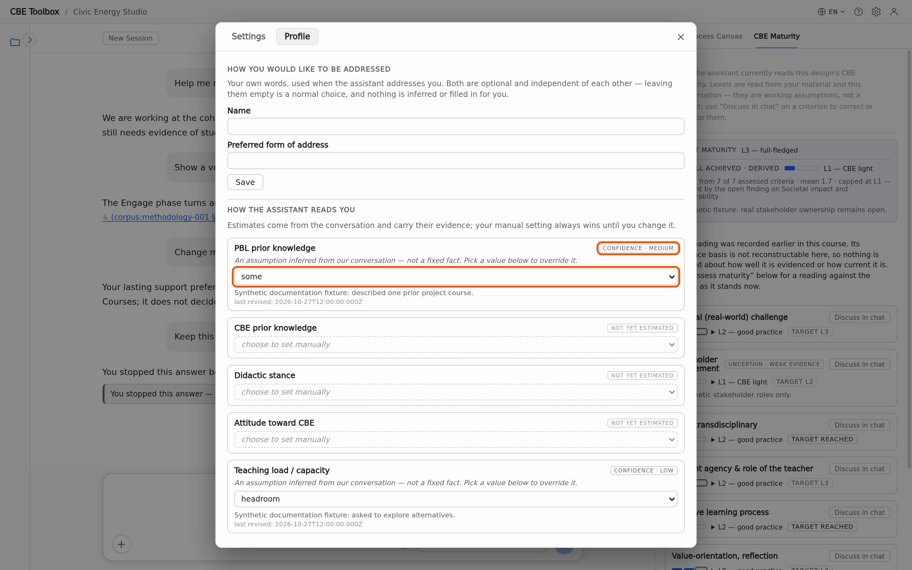

_The Profile pane: the Toolbox's estimate with its confidence (top highlight) and the selector you use to override it (bottom highlight). The values shown are synthetic documentation fixture content._

<!-- topic:attachment-versus-wiki -->

## Attachment or course Wiki?

You can give the Toolbox your own material in two ways:

- An **attachment** (one-time upload) is for material that matters for your next message, for example a draft you want feedback on now. It is read for that one message only.
- The **course Wiki** is for material you want to come back to in this Course, for example an existing module description, a timetable or literature. The Toolbox turns each imported document into short, searchable notes (the app calls them atoms) and can draw on them in all later Chats of the Course.

<!-- screenshot:attachment-and-wiki:overview:desktop -->

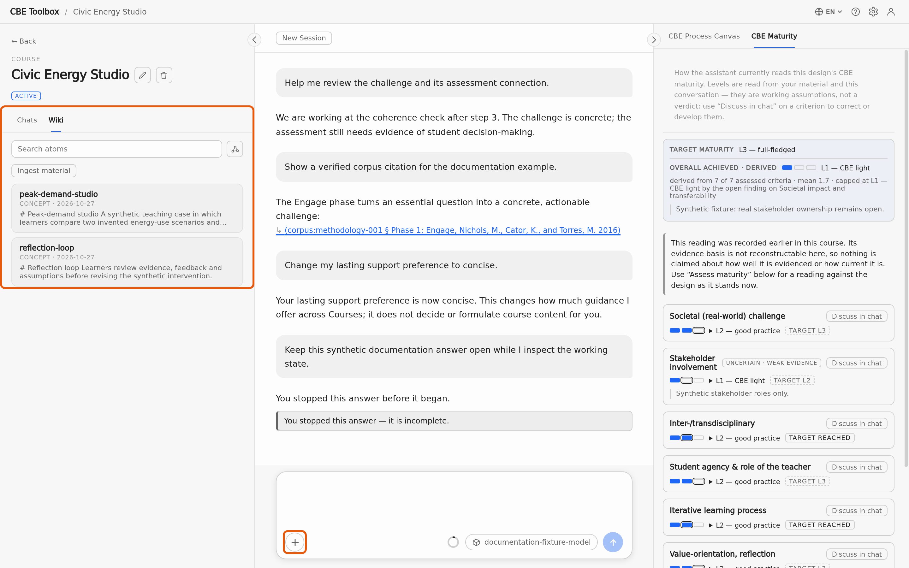

_Where to find each route: the plus button in the message field for a one-time attachment (bottom highlight) and the Course's Wiki tab in the left panel (left highlight)._

### Attach a file to a message

Select the plus button at the bottom left of the message field. Its menu lets you upload files as an attachment or get conversational help. An attached file appears as a removable item above the message field and is sent with your next message. It is not added to the Wiki.

<!-- ui:material-upload -->

<!-- screenshot:composer-plus-menu:default:desktop -->

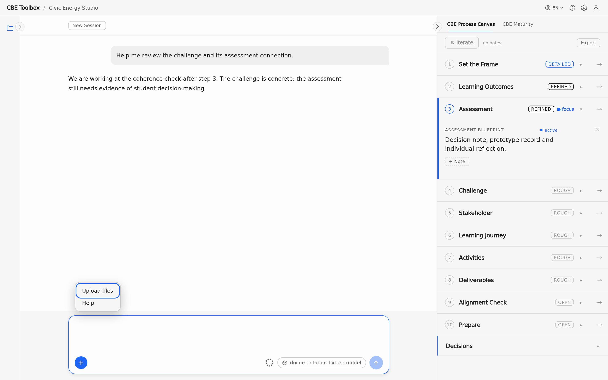

_The menu behind the plus button in the message field offers file upload and conversational Help._

<!-- formats:SUPPORTED_EXTENSIONS -->

Attachments and Wiki imports accept the same file types: **PDF, DOCX, PPTX, XLSX, TXT, MD and CSV**. CSV remains text. For XLSX, sheet names, cell positions, empty cells, the stored results of formulas, dates (in ISO format) and merged cells are preserved. Old or macro-capable Excel forms (`.xls`, `.xlsb`, `.xlsm`) are refused by name; save a copy as `.xlsx` and retry.

<!-- topic:wiki-ingestion -->

## Import material into the Wiki

Open the Course in the left side panel and switch to its Wiki tab. The import button below the search field lets you choose files from your computer. Each document shows its own progress; if one document fails, the others are still imported. You can abort an import and try again. If you switch to another Course meanwhile, the import continues for the Course where you started it. When it has finished, the new notes appear in the Wiki list. Only local files are accepted; web pages, feeds and other network sources are not fetched.

<!-- screenshot:wiki-ingestion-progress:default:desktop -->

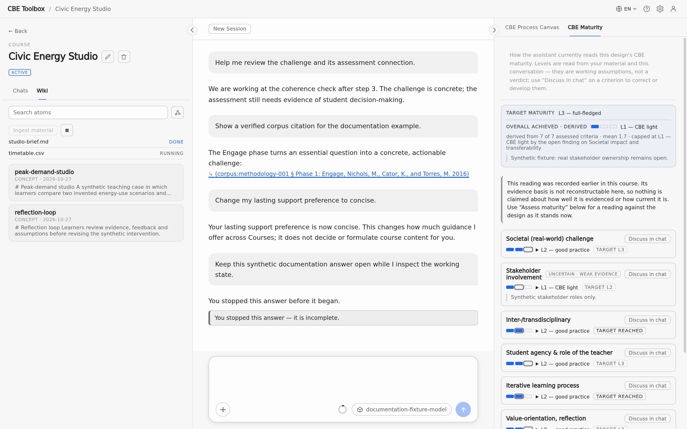

_The Wiki shows separate progress rows for a completed and a running document._

<!-- topic:wiki-use -->

## Browse and search the Wiki

In the Course's Wiki tab, type into the search field to filter the notes by words from the headings, metadata or body text of the ingested material. Open a note to see its source details and related notes. The button directly to the right of the search field switches between the list and the graph view, which shows how the notes are linked. Both views show the same notes.

<!-- screenshot:wiki-browser:list:desktop -->

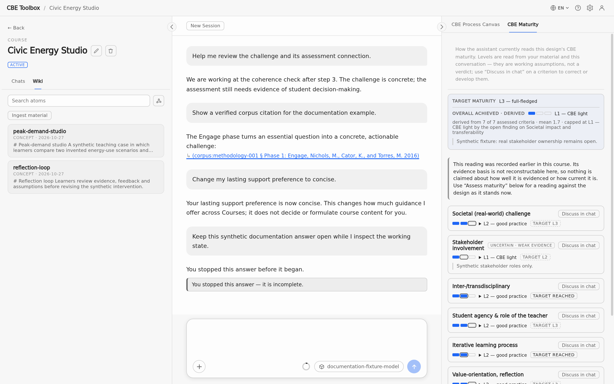

_The list view shows searchable Wiki notes and their previews._

<!-- screenshot:wiki-browser:graph:desktop -->

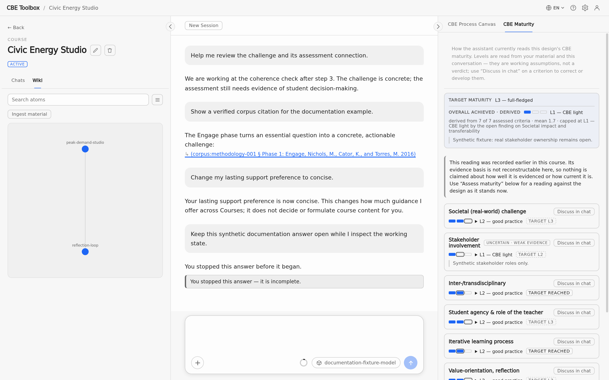

_The graph view shows the links between the same Wiki notes._

<!-- topic:sources-and-citations -->

## Sources and citations

The curated corpus contains CBE methodology; the Course Wiki contains your reusable course material. If the same source exists in both, the active Course's Wiki takes precedence. A citation appears in the assistant's answer as an underlined link in brackets, for example “(corpus:methodology-001 § …)” for the corpus or “(wiki:…)” for your Course Wiki. Select it to open the source in a window above the app: it shows the document's title and details and the cited text, so you can check the source. Close the window to return to the conversation. A corpus citation is verified against the corpus; a Wiki citation resolves through that Course's index.

<!-- screenshot:citation-source:default:desktop -->

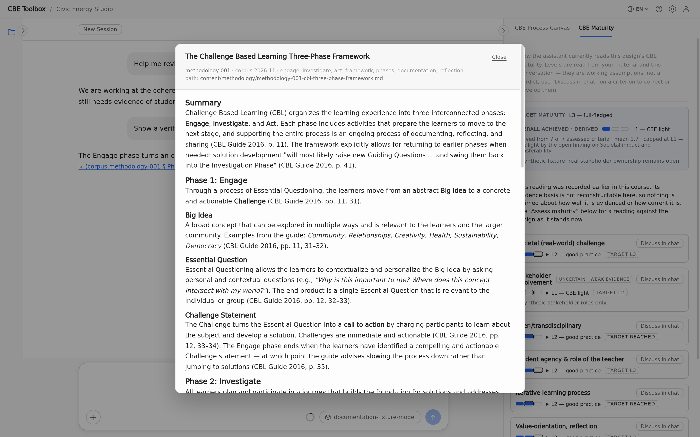

_The source view shows the cited passage and its document details._

The assistant may make a working suggestion when the available sources do not support a claim. It must clearly label the suggestion as unverified.

<!-- topic:settings -->

## Interface language and Settings

### Interface language

Change the language of the app's menus and labels with the language selector (globe icon) at the top right of the application window. The change applies immediately; it does not choose the language of your teaching content.

<!-- ui:header-interface-language -->

<!-- screenshot:language-selector:default:desktop -->

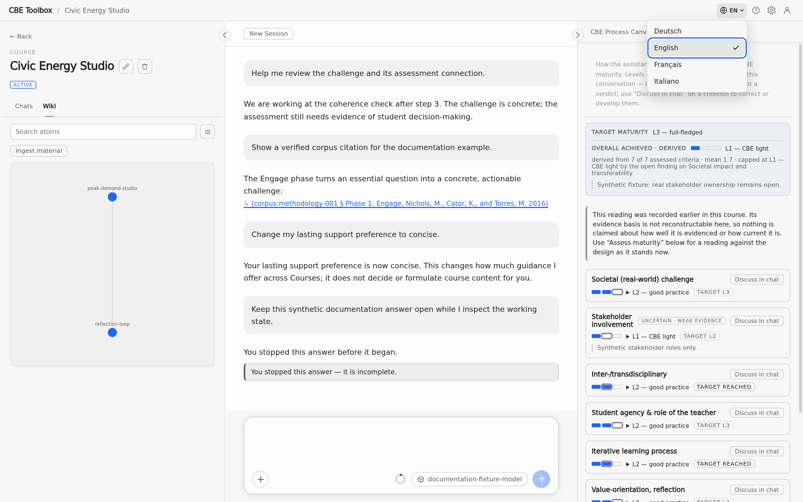

_The open selector lists the available interface languages._

### Open Settings

Open Settings from the settings gear at the top right of the application window, or with `Cmd+,` on macOS or `Ctrl+,` on Windows/Linux. How to set up the model connection is described in [Connect a model](installation-and-local-it.md#model-connection). `F1` opens Help.

<!-- ui:settings-gear -->
<!-- ui:settings-panel -->
